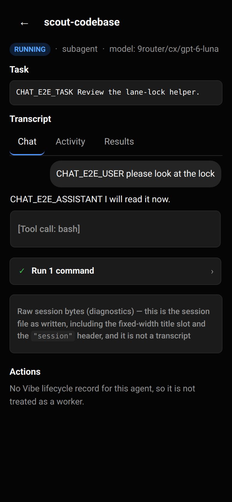

# Hướng dẫn sử dụng Coding Agent Web

Tài liệu dành cho người mới dùng Coding Agent Web (CAW) trên Ubuntu cá nhân và điều khiển bằng iPhone. Mô tả hành vi đang có thể kiểm tra trong mã nguồn và tài liệu vận hành; giao diện có thể được cập nhật trong quá trình phát triển.

## Mục lục

1. [Giới thiệu](#1-giới-thiệu)
2. [Truy cập từ điện thoại](#2-truy-cập-từ-điện-thoại)
3. [Projects](#3-projects)
4. [Conversations](#4-conversations)
5. [History](#5-history)
6. [Giải thích mọi trạng thái](#6-giải-thích-mọi-trạng-thái)
7. [Phân biệt các thao tác](#7-phân-biệt-các-thao-tác)
8. [Sử dụng cùng một conversation trên Ubuntu và iPhone](#8-sử-dụng-cùng-một-conversation-trên-ubuntu-và-iphone)
9. [Công cụ và giao diện chat](#9-công-cụ-và-giao-diện-chat)
10. [Lệnh `/handoff` — nén ngữ cảnh tại chỗ](#10-lệnh-handoff--nén-ngữ-cảnh-tại-chỗ)
11. [Giới hạn và bảo mật](#11-giới-hạn-và-bảo-mật)
12. [Troubleshooting](#12-troubleshooting)
13. [FAQ](#13-faq)
14. [Giao diện di động mới (thanh trên, menu, nút Latest)](#14-giao-diện-di-động-mới-thanh-trên-menu-nút-latest)
15. [Nhóm hoạt động tool (agent activity)](#15-nhóm-hoạt-động-tool-agent-activity)
16. [Tóm tắt thay đổi tệp và ý nghĩa của +/−](#16-tóm-tắt-thay-đổi-tệp-và-ý-nghĩa-của--)
17. [Mở diff: dòng thêm, dòng bỏ, ngữ cảnh](#17-mở-diff-dòng-thêm-dòng-bỏ-ngữ-cảnh)
18. [Phân biệt "thay đổi của agent" và "thay đổi của workspace"](#18-phân-biệt-thay-đổi-của-agent-và-thay-đổi-của-workspace)
19. [Khi không có diff](#19-khi-không-có-diff)
20. [Nội dung bị ẩn, bị cắt, hay không có](#20-nội-dung-bị-ẩn-bị-cắt-hay-không-có)
21. [Bàn phím và cuộn trên điện thoại](#21-bàn-phím-và-cuộn-trên-điện-thoại)
22. [Advisor — mô hình review thứ hai](#22-advisor--mô-hình-review-thứ-hai)
23. [Vibe mode — director và worker](#23-vibe-mode--director-và-worker)
24. [Giao diện mới: chat gọn, Agents Center, thu gọn prompt dài](#24-giao-diện-mới-chat-gọn-agents-center-thu-gọn-prompt-dài)
25. [Vòng 54 — tinh chỉnh giao diện di động](#25-vòng-54--tinh-chỉnh-giao-diện-di-động)
26. [Mở một agent và đọc hội thoại thật](#26-mở-một-agent-và-đọc-hội-thoại-thật)
27. [Trung tâm Tệp (Files Center)](#27-trung-tâm-tệp-files-center)
28. [Màu sắc diff và cách đọc](#28-màu-sắc-diff-và-cách-đọc)
29. [Dòng thời gian Hoạt động (Activity)](#29-dòng-thời-gian-hoạt-động-activity)
30. [Menu hành động trên di động](#30-menu-hành-động-trên-di-động)
31. [Chỉ báo Advisor](#31-chỉ-báo-advisor)
32. [Điều hướng và nút Back](#32-điều-hướng-và-nút-back)
33. [Giới hạn đã biết](#33-giới-hạn-đã-biết)
34. [Giới hạn số agent chạy song song (Agent limits)](#34-giới-hạn-số-agent-chạy-song-song-agent-limits)

## 1. Giới thiệu

CAW là giao diện web riêng tư để điều khiển các coding agent OMP đang chạy trên laptop Ubuntu. OMP thực hiện công việc và chạy công cụ trên laptop; CAW cung cấp danh sách project, conversation, transcript và giao diện chat. CAW không thay OMP, không lưu thông tin đăng nhập nhà cung cấp AI thay OMP và không chạy agent trên iPhone.

Laptop chạy server, OMP, tmux và tiến trình agent. Tmux giúp agent tồn tại độc lập với tab trình duyệt. iPhone chạy Safari hoặc PWA để đăng nhập, gửi prompt, xem hoạt động và điều khiển qua mạng.

Trên máy này, ứng dụng web/API nghe tại `127.0.0.1:8791`; Collab relay riêng nghe tại `127.0.0.1:8792`. Tailscale Serve cung cấp HTTPS nội bộ tailnet và chuyển tiếp tới cổng 8791. Cả laptop và iPhone phải kết nối cùng tailnet. Chỉ proxy cổng 8791; không proxy cổng relay 8792 và không bật Tailscale Funnel.

Tài liệu liên quan: [kiến trúc vòng đời session](architecture/session-lifecycle.md), [mô hình bảo mật](architecture/security-model.md), [cài đặt Ubuntu](operations/ubuntu-setup.md), [truy cập iPhone](operations/iphone-access.md), [thiết lập và dùng iPhone](operations/iphone-setup.md).

## 2. Truy cập từ điện thoại

1. Kết nối Tailscale trên laptop và iPhone, đăng nhập cùng tailnet. Trên laptop kiểm tra bằng `tailscale status`.
2. Mở Safari trên iPhone và truy cập [https://heheboiz-legion-5-15arh7.tail8d8eff.ts.net](https://heheboiz-legion-5-15arh7.tail8d8eff.ts.net). Dùng đúng HTTPS, không thêm cổng. Tùy chọn: trong Safari chọn Chia sẻ → Thêm vào Màn hình chính để cài PWA.
3. Đăng nhập bằng mật khẩu CAW. Ở lần khởi động đầu, server in ra stdout **đường dẫn** tệp setup token cùng lệnh `cat` để đọc; server **không in token**. Trên máy này, tệp là `/home/heheboiz/.local/state/coding-agent-web/setup-token`. Lệnh đọc trên máy này:

   ```bash
   cat /home/heheboiz/.local/state/coding-agent-web/setup-token
   ```

   Token dùng một lần, hết hạn sau 15 phút. Nhập token ở màn hình đăng nhập rồi đặt mật khẩu ít nhất 12 ký tự.
4. Nếu không mở được web, kiểm tra Tailscale, Serve và service theo [Troubleshooting](#12-troubleshooting).

**Serve không phải Funnel:** Serve cấp HTTPS chỉ trong tailnet. Funnel có thể công khai dịch vụ ra Internet; tuyệt đối không bật cho CAW. Không proxy cổng relay 8792 qua Serve. Xem [hướng dẫn truy cập iPhone](operations/iphone-access.md).
**Giới hạn xác minh:** truy cập từ iPhone vật lý chưa được kiểm tra trong môi trường này; tài liệu vận hành đã xác nhận URL từ laptop qua tailnet. Hành vi Safari/PWA khi ngủ, bàn phím và reconnect cần kiểm tra trên thiết bị thật.


Nếu quên mật khẩu, làm theo [hướng dẫn khôi phục](operations/recovery.md#i-lost-my-password). Thao tác khôi phục cần dừng server và xóa credential; không làm khi còn người dùng app hoặc khi không chắc service thuộc quyền quản lý của bạn.

## 3. Projects

Project là thư mục laptop được đăng ký trong CAW. Conversations mới chạy trong thư mục đó; các native session OMP được nhóm theo thư mục làm việc. Project không sao chép thư mục sang iPhone.

Thêm project: **Projects** → **New Project** → duyệt tới thư mục → chọn → nhập nhãn → **Create**. Folder Browser chỉ hiển thị các thư mục trong `allowedRoots`; có thể tạo thư mục con từ giao diện nếu cần. Nhãn project chỉ là tên hiển thị. Xóa project chỉ xóa metadata, không xóa thư mục hay tệp; việc xóa project có thể bị từ chối nếu còn conversation chưa được xác nhận đã dừng.

Trên máy này, `caw.config.json` đặt `allowedRoots` là `/home/heheboiz/data`. Do đó thư mục nằm ngoài cây này không xuất hiện và không thể được duyệt qua CAW. Đường dẫn được chuẩn hóa trước khi kiểm tra; không coi allowlist này là sandbox cho agent: tiến trình OMP chạy dưới tài khoản của bạn và có thể truy cập những gì tài khoản đó cho phép.

Xem [cấu hình Ubuntu](operations/ubuntu-setup.md#3-configure) để biết ý nghĩa của `allowedRoots`.

## 4. Conversations

Conversation là bản ghi CAW gắn với project và có thể gắn với native OMP session. Mở project rồi nhấn **New chat** để tạo conversation mới. Gõ prompt vào ô chat và chọn **Send**. OMP chạy trên laptop; phản hồi sẽ xuất hiện trong giao diện khi dữ liệu được nhận.

Trong phần **Conversation model settings**, chọn model từ danh sách OMP hoặc nhập model ID tùy chỉnh. **Save model** lưu lựa chọn cho lần khởi chạy sau, không đổi model của tiến trình đang chạy. **Save & restart agent** yêu cầu khởi chạy lại conversation với model đã chọn. Danh sách model có thể trống hoặc không khả dụng nếu OMP không cung cấp catalog.

Khi agent đang chạy, nút **Stop generating** gửi lệnh abort để kết thúc lượt đang làm việc; tiến trình OMP vẫn sống, nên có thể gửi prompt tiếp theo. Muốn kết thúc hẳn tiến trình do CAW quản lý, dùng **Stop OMP session** (có hộp xác nhận khi đang có lượt chạy, approval hoặc subagent); thao tác này giải phóng một slot agent nhưng giữ nguyên journal và conversation. Conversation đã dừng có thể dùng **Restart** để khởi chạy lại với lịch sử đã ghi. Nút mở conversation từ danh sách project chỉ mở giao diện; nó không tự khởi chạy agent. Muốn quay lại transcript đã lưu, mở conversation và dùng chế độ lịch sử khi live host không có.

Giới hạn mặc định trên máy này là tối đa **3 agent chính đang hoạt động**. Đạt giới hạn thì lần khởi chạy khác có thể bị từ chối; dừng hoặc chờ một agent thay vì tạo thêm.

## 5. History

OMP ghi session journal gốc ở `~/.omp/agent/sessions/<encoded-cwd>/<timestamp>_<uuid>.jsonl`. Đây là lịch sử native của OMP, độc lập với metadata CAW trong `/home/heheboiz/.local/state/coding-agent-web`. Một journal đã lưu không chứng minh agent còn chạy.

**History** ở trang Projects mở danh sách session OMP toàn cục — chức năng này tương ứng với “All OMP Conversations”. Danh sách có thể tìm theo tiêu đề, đường dẫn hoặc session ID; nhóm theo project hoặc đường dẫn, sắp xếp hoạt động gần nhất trước. Dùng **Load more** để phân trang. Danh sách có giới hạn quét; nếu có thông báo incomplete, đó là phần đầu tìm được chứ không phải toàn bộ. Giao diện cho biết số tệp đã quét, session ngoài roots bị loại và tệp không phải journal bị bỏ qua.

Chọn **View history** để đọc transcript journal ở chế độ chỉ đọc; thao tác này không gửi prompt và không khởi chạy agent. Dùng **Load older** để đọc trang cũ. Nếu journal đang có writer hoặc không xác định được writer, việc đọc có thể bị chặn để tránh đọc snapshot đang thay đổi. Một số bản ghi quá lớn hoặc dữ liệu bị cắt có thể làm transcript hiển thị không đầy đủ; journal gốc không bị sửa bởi thao tác xem.

Mỗi dòng session có các nút theo trạng thái của nó: session **đã tracked** hiển thị **Open conversation** và mở thẳng conversation CAW đã liên kết; session **chưa tracked**, đã dừng, thư mục còn tồn tại và thư mục đã là project hiển thị **Resume**; session đang live có host và relay xác nhận hiển thị **Open live**; khi chưa đủ điều kiện, nút tương ứng bị vô hiệu kèm lý do thay vì biến mất.

`History-only` là session có journal nhưng thư mục làm việc không còn tồn tại. Có thể xem lịch sử nếu đọc được, nhưng không thể Resume vào thư mục đã mất. Native session chưa thuộc project đã đăng ký vẫn có thể hiện trong danh sách toàn cục nếu nằm trong `allowedRoots`; phải thêm thư mục đó thành project trước khi Resume.

Trên máy này đã kiểm kê 61 journal: 49 nằm trong `allowedRoots`, 12 nằm ngoài nên không được hiển thị. Số lượng có thể thay đổi theo máy và thời điểm.

## 6. Giải thích mọi trạng thái

Các nhãn dưới đây không cùng một loại trạng thái. `Tracked` là quan hệ với metadata CAW; `Running`/`Stopped` nói về runtime; `Live`/`Unknown` là kết quả quan sát writer; `External` là quyền sở hữu. Một session có thể đồng thời **Tracked và Stopped**. `Tracked` không có nghĩa là đang chạy.

| Nhãn | Ý nghĩa |
|---|---|
| **Tracked** | CAW đã có conversation liên kết với native session đó. Có thể đang chạy hoặc đã dừng. Mục native session hiển thị **Open conversation** để đi thẳng tới conversation đó; **Resume** không được đưa ra vì session đã có liên kết. |
| **Untracked** | Chưa có conversation CAW liên kết session native đó. Đây là thuộc tính liên kết, không nói session còn chạy hay không. |
| **Running** | OMP báo có lượt đang chạy trong host được xác nhận. Không đồng nghĩa với hoàn tất. |
| **Stopped** | Process do CAW quản lý đã dừng và native journal vẫn đọc được. Có thể mở conversation hoặc dùng hành động thử lại phù hợp. |
| **Saved** | Transcript đọc từ journal đã lưu, trình bày chỉ đọc. Đây là nguồn hiển thị lịch sử, không phải trạng thái process. |
| **Live** | Có writer lease được quan sát là đang tồn tại; để mở live trong web còn cần host Collab và relay được xác nhận kết nối. |
| **Unknown** | Không thể xác minh trạng thái writer/host. Không có nghĩa là stopped hay idle; CAW chặn thao tác có thể tạo writer thứ hai. |
| **External** | Host/session có thật nhưng process không được CAW khởi chạy và CAW không sở hữu vòng đời của nó. Web có thể gắn viewer nếu Collab hoạt động, nhưng không thể Restart như conversation managed. |
| **History-only** | Journal còn nhưng thư mục làm việc không còn tồn tại. Đây là khả năng phục hồi đường dẫn, không phải runtime state. |
| **Awaiting input** | Agent đang chờ câu hỏi/yêu cầu đầu vào của chủ máy, chẳng hạn approval. Không phải trạng thái đã hoàn tất. |
| **Disconnected** | Kết nối trình duyệt tới live room đã mất; không chứng minh process đã dừng. Có thể thử kết nối lại. |
| **Reconnecting** | Trình duyệt đang thử lập lại kết nối live. Đây là trạng thái kết nối, độc lập với process OMP. |

Các trạng thái runtime chính xác trong hợp đồng CAW: `starting`, `running`, `idle`, `awaiting_input`, `stopping`, `stopped`, `error`, `unknown`. `idle` chỉ có nghĩa hiện không có lượt đang chạy; OMP có thể còn việc chờ, vì thế không nên hiểu là đã hoàn tất. `error` có thể cho biết process đã mất và journal không đọc được.

Một session **tracked luôn hiển thị nút Open conversation** (ở History toàn cục và ở danh sách native session trong project) để mở đúng conversation CAW đã liên kết, nên tracked không bao giờ là ngõ cụt. Ngược lại, session **untracked** chỉ có **Resume** khi đã dừng, thư mục còn tồn tại và thư mục đó đã là project.

## 7. Phân biệt các thao tác

Bảng mô tả ý nghĩa và tác động theo hành vi UI/API. “Slot” là một trong tối đa ba agent chính hoạt động; việc chỉ đọc hoặc mở viewer không tạo slot mới.

| Thao tác | Làm gì | Tạo process OMP mới? | Dùng slot mới? | Sửa native history? | Có thể tạo fork? | An toàn khi nào; sau đó |
|---|---|---:|---:|---|---|---|
| **View history** | Đọc transcript journal trong giao diện chỉ đọc. | Không | Không | Không; chỉ đọc. | Không | Dùng để xem lịch sử. Có thể bị chặn khi writer đang chạy hoặc không xác minh được. |
| **Resume** | Tạo conversation CAW gắn với native session cũ và khởi chạy OMP dựa trên journal đó. Sau đó session được Tracked; prompt bị ngắt không tự phát lại. | Có, nếu được chấp nhận | Có | Có; OMP có thể ghi tiếp cùng journal | Không chủ ý | Chỉ khi writer đã xác nhận không hoạt động, thư mục còn tồn tại và đã đăng ký project. Nếu lease unknown/live, thao tác bị chặn. |
| **Open conversation** | Bấm nút **Open conversation** trên mục session đã tracked (ở History toàn cục hoặc danh sách native session trong project) để mở đúng conversation CAW đã liên kết; nếu có Collab host, giao diện có thể kết nối room. | Không | Không thêm slot | Không bởi thao tác mở | Không | Dùng để trở lại conversation đã tracked; không phải Resume, và không cần rời trang để tìm lại conversation. |
| **Open live** | Gắn CAW conversation external vào native session đang chạy có host và relay kết nối; mở viewer. | Không | Không tạo agent process/slot mới | Không bởi thao tác gắn | Không | Khi writer và Collab host/relay đều được xác nhận. External process vẫn do người khởi chạy quản lý. |
| **Attach from terminal** | Kết nối terminal laptop vào tmux session managed đã có qua private socket. | Không | Không | Không bởi attach; OMP tiếp tục có thể ghi journal như thường | Không | Dùng lệnh CAW đưa ra cho đúng conversation. Thoát attach bằng `Ctrl-b`, rồi `d`; không gửi lệnh dừng. |
| **Stop generating** | Gửi lệnh abort qua Collab để kết thúc **lượt đang chạy**. | Không | Không | Việc đã xảy ra có thể đã được OMP ghi vào journal; không xoá lịch sử | Không | Dùng khi chỉ muốn dừng lượt hiện tại; **tiến trình OMP vẫn sống** và có thể nhận prompt tiếp theo. |
| **Stop OMP session** | Gọi hành động dừng của server để kết thúc **tiến trình OMP do CAW quản lý** và giải phóng slot agent. | Không (kết thúc process, không tạo mới) | Có — giải phóng một slot trong tối đa 3 | Journal và conversation được giữ nguyên, không xoá | Không | Chỉ với session managed. Có hộp xác nhận khi đang có lượt chạy, approval hoặc subagent. Sau khi dừng, conversation vẫn xem được và **Restart** được theo các guard an toàn hiện có. |
| **Handoff (`/handoff`)** | Gửi lệnh gốc `/handoff` của OMP vào pane managed để nén ngữ cảnh tại chỗ. | Không | Không | Có — OMP ghi một compaction entry; journal cũ và session id giữ nguyên | Không | Chỉ với session managed, writer đã xác minh idle, không có terminal attach, không đang stream/handoff khác. Tốn token AI. Chi tiết ở [chương 10](#10-lệnh-handoff--nén-ngữ-cảnh-tại-chỗ). |
| **Restart** | Với conversation managed, dừng/khởi chạy lại và tiếp tục native session liên kết khi có. | Có (khởi chạy lại) | Có | Tiếp tục ghi lịch sử native đang gắn | Không chủ ý | Chỉ khi sở hữu conversation và chấp nhận gián đoạn. External hoặc identity không xác minh được sẽ bị từ chối. |
| **Create new conversation** | Tạo conversation mới trong project. | Có | Có | Tạo native session mới khi OMP khởi chạy | Không | Dùng cho công việc mới, không phải cách mở lịch sử cũ. |
| **Fork (khi được hỗ trợ)** | Fork sẽ tạo nhánh session theo khả năng của OMP. | Chưa xác minh trong UI hiện tại | Chưa xác minh | Có thể tạo journal/nhánh riêng tùy OMP | Có theo ý nghĩa fork, nhưng không được CAW hứa hẹn | Không thấy thao tác Fork trong giao diện CAW đã đọc; dùng khả năng OMP trực tiếp chỉ khi đã hiểu tác động. |

Không thử Resume nhiều lần để “mở lại” conversation; session đã tracked có nút **Open conversation** để mở thẳng conversation đã liên kết. Khi writer live hoặc unknown, dừng lại và tìm host hiện có thay vì tạo writer mới.

**Hai hành động dừng khác nhau, đừng nhầm:** **Stop generating** chỉ kết thúc lượt đang chạy và để tiến trình OMP sống; **Stop OMP session** kết thúc tiến trình OMP do CAW quản lý và giải phóng slot. Không hành động nào xoá lịch sử. Cả hai chỉ áp dụng cho session **do CAW quản lý**; session external không dừng được từ CAW, phải dừng tại terminal của nó.

## 8. Sử dụng cùng một conversation trên Ubuntu và iPhone

### Bắt đầu trên Ubuntu, tiếp tục trên iPhone

1. Mở CAW trên Ubuntu hoặc iPhone và đăng nhập.
2. Vào project rồi **New chat**, gửi prompt. Agent chạy trên laptop trong tmux riêng.
3. Mở cùng project/conversation trên iPhone. CAW mở liên kết Collab tới host hiện có, không cần chạy agent lần thứ hai.
4. Nếu Safari ngủ hoặc mất mạng, giao diện có thể báo Disconnected/Reconnecting. Khi kết nối lại, CAW đồng bộ lại từ host; trạng thái mất kết nối không dừng OMP.

### Bắt đầu trên iPhone, attach từ Ubuntu

1. Tạo conversation và gửi prompt từ iPhone.
2. Mở cùng conversation trên laptop. Trong phần hướng dẫn attach, CAW hiển thị lệnh chính xác cho session đó.
3. Dạng lệnh trên máy này:

```bash
tmux -S /home/heheboiz/.local/state/coding-agent-web/tmux.sock attach -t '<session_id>'
```

Thay `<session_id>` bằng ID mà CAW đưa ra; không đoán tên tmux. Để thoát terminal mà không dừng OMP, nhấn `Ctrl-b`, rồi `d` (detach). Đóng terminal sau khi detach.

### Đóng Safari mà không dừng OMP

Đóng tab hoặc để iPhone ngủ chỉ ngắt viewer. OMP tiếp tục chạy trong tmux và có thể tiếp tục dùng tài nguyên hoặc thực hiện công cụ. Đóng trình duyệt không phải lệnh dừng nào cả; muốn kết thúc lượt đang chạy, dùng **Stop generating**; muốn kết thúc tiến trình do CAW quản lý, dùng **Stop OMP session**.

### Resume native session cũ

1. Mở **History**, tìm session và kiểm tra trạng thái writer.
2. Nếu `live` là false, thư mục còn tồn tại và project đã đăng ký, chọn **Resume**.
3. CAW tạo conversation liên kết session native; từ thời điểm đó mục sẽ là **Tracked**, và mục đó hiển thị nút **Open conversation** để mở thẳng conversation vừa tạo — cả ở History toàn cục lẫn ở danh sách native session trong project. Tracked không khẳng định agent đang chạy.

### Khi đã có writer hoạt động

Không Resume hoặc Restart thêm lần nữa. Nếu session live có host/relay, dùng **Open live** hoặc mở conversation CAW đã quản lý. Nếu đó là OMP chạy thủ công trong terminal và không có Collab host, điều khiển qua terminal hiện có; CAW không thể tự tạo viewer Collab cho host không được xác nhận.

OMP bảo vệ session native bằng writer lease. CAW kiểm tra lease trước khi tạo writer; lease đang giữ hoặc không xác minh được thì từ chối. Mở một writer thứ hai có thể làm rẽ nhánh/làm hỏng lịch sử. Cần phân biệt **vòng đời kết nối trình duyệt** (có thể ngắt, nối lại) với **vòng đời process OMP** (sống trong tmux, không phụ thuộc tab).

### Sau khi service restart hoặc laptop reboot

Service backend có thể khởi động lại trong khi agent managed còn sống; khi lên lại, CAW đối chiếu tmux, Collab registry và journal để nhận diện. Nếu không đủ bằng chứng, trạng thái là unknown chứ không đoán đã dừng. Sau khi laptop reboot, các process thường đã mất nhưng journal vẫn còn; dùng History để xem và Resume có chủ ý. Prompt bị ngắt không tự phát lại. Xem [phục hồi](operations/recovery.md) và [triển khai service](operations/deployment.md).

## 9. Công cụ và giao diện chat

Giao diện hiển thị tin nhắn người dùng/trợ lý, nội dung streaming khi nhận được, hàng kết quả tool có thể mở/đóng, trạng thái tool đang chạy hoặc lỗi, và sự kiện hoạt động trong **Activity**. Transcript tool dùng dữ liệu OMP/Collab mà client nhận; CAW không đọc terminal để tự dựng lại mọi output.

Khi OMP cần phản hồi UI, CAW hiển thị yêu cầu/approval cùng các lựa chọn hoặc ô nhập. Người dùng có thể gửi phản hồi hoặc hủy; link read-only không thể trả lời, gửi prompt, **Stop generating** hay **Stop OMP session**. Không tự động phê duyệt khi điện thoại mất kết nối. Panel **Agents** cho phép xem agent con và transcript được yêu cầu theo từng phần.

Giao diện có ô prompt, gợi ý một số slash command, trạng thái kết nối, nút **Latest** nổi khi đã cuộn khỏi cuối transcript, lựa chọn model và transcript lịch sử đọc-only. Thanh trên gọn: **Stop generating** luôn hiện trực tiếp khi agent đang chạy, còn **Handoff context** và **Stop OMP session** nằm trong menu **⋯ More actions** (mỗi mục có thể bị vô hiệu kèm lý do khi không dùng được). Chi tiết: [chương 14](#14-giao-diện-di-động-mới-thanh-trên-menu-nút-latest). Khi gõ một lệnh gốc của OMP như `/handoff`, CAW không gửi nó như prompt mà hiển thị hộp xác nhận; xem [chương 10](#10-lệnh-handoff--nén-ngữ-cảnh-tại-chỗ). Khi gửi prompt chưa được xác nhận, CAW có thể báo chưa rõ host đã nhận hay chưa; đừng gửi lại một cách mù quáng vì prompt có thể đã chạy.

**Giới hạn khác:** nếu mục tracked không hiển thị **Open conversation**, giao diện ghi “Tracked conversation ID is unavailable” (nút chỉ xuất hiện khi session có conversation ID). Khi đó dùng **Projects** để mở project và chọn conversation.

**Hạn chế:** không thấy chức năng đính kèm tệp từ giao diện chat; chia sẻ đường dẫn trong prompt không phải upload tệp. Tool call giờ được gom theo nhóm và có trình xem diff cho thay đổi tệp — xem [chương 15](#15-nhóm-hoạt-động-tool-agent-activity), [16](#16-tóm-tắt-thay-đổi-tệp-và-ý-nghĩa-của--) và [17](#17-mở-diff-dòng-thêm-dòng-bỏ-ngữ-cảnh). Nếu host không gửi diff, CAW nói rõ là không có diff thay vì tự bịa số dòng. Không hứa rằng mọi tool output, nội dung lịch sử cũ, trạng thái con hoặc sự kiện đều có mặt: OMP/Collab có thể không gửi, trang transcript có thể bị giới hạn hoặc một bản ghi quá lớn bị bỏ qua khi hiển thị. Chi tiết giao diện này có thể mở rộng khi các phần đang được cải thiện.

## 10. Lệnh `/handoff` — nén ngữ cảnh tại chỗ

`/handoff` là **lệnh gốc (builtin) của OMP**, không phải prompt gửi cho model. Nó được OMP xử lý trong terminal của session và ghi thêm một **compaction entry tại chỗ** vào cùng session đó.

### `/handoff` khác `/compact` thế nào

Cả hai đều ghi một **compaction entry tại chỗ trên cùng một session** (không tạo session mới, không tạo process mới, không xoá lịch sử). Khác nhau ở nguồn văn bản dùng làm phần tóm tắt:

| Lệnh | Phần tóm tắt lấy từ đâu | Ai chạy được từ CAW |
|---|---|---|
| `/handoff` | Văn bản bàn giao (handoff document) do OMP tạo và dùng làm phần tóm tắt ngữ cảnh | Có — nút **Handoff context** hoặc gõ `/handoff` trong ô chat |
| `/compact` | Bản tóm tắt thông thường | Không — CAW không có điều khiển Collab cho `/compact`; chạy trong terminal OMP |

### Có tạo session mới không? Có mất lịch sử không? Có tốn token không?

- **Không tạo session mới.** Session id, tệp journal và conversation giữ nguyên; chỉ phần ngữ cảnh cũ được nén lại.
- **Không mất lịch sử cũ.** Journal không bị xoá; các entry cũ vẫn còn trên đĩa và vẫn đọc được.
- **Có tốn token AI.** OMP phải gọi model để tạo bản tóm tắt/handoff document, nên thao tác này tiêu thụ token.

### Cách dùng trên iPhone

1. Mở conversation trong CAW (bắt buộc là conversation do CAW quản lý, xem điều kiện bên dưới).
2. Chọn một trong hai cách:
   - gõ `/handoff` trong ô chat. Chuỗi này **không** được gửi như prompt cho model: CAW nhận ra đây là lệnh gốc, hiển thị hộp xác nhận rồi yêu cầu server gõ lệnh vào terminal managed của session;
   - hoặc bấm nút **Handoff context** trong khu vực hành động của conversation, rồi bấm **Run handoff**.
3. Xác nhận. Có **ba** kết quả khác nhau, và CAW phân biệt rõ ràng:
   - **“Handoff delivered — OMP may still be generating; the transcript will show the compression when it commits.”** — lệnh đã được gõ vào pane, nhưng CAW **chưa thấy** compaction entry nào trong journal. OMP có thể còn đang sinh nội dung, có thể đã từ chối (`Nothing to hand off`), hoặc có thể không nhận ra lệnh. Đây **không** phải là “đã nén xong”.
   - **“Handoff refused — the agent declined it (nothing to hand off). Nothing was compacted…”** — OMP **tự nói** nó từ chối (văn bản từ chối của agent được thấy trong pane). Đây là bằng chứng chắc chắn rằng lần này không nén gì cả, nên **không** có lượt nào đang chạy phía sau: bạn có thể chạy lại ngay khi đã có ngữ cảnh để nén. Banner hiện màu vàng (cảnh báo) để không bị đọc nhầm thành “đã gửi thành công”.
   - **“Handoff committed — the journal records the compaction.”** — journal của session đã có entry `compaction` với `method: "handoff"`, kèm id bằng chứng. Chỉ khi đó mới là đã nén xong thật.

**Rủi ro với bản nháp chưa gửi trong terminal.** `/handoff` được dán vào pane đang chạy. Nếu trong editor của terminal đó còn **bản nháp chưa gửi**, phần dán sẽ nối vào giữa dòng:

```
UNSENT_DRAFT_SENTINEL_alpha /handoff
```

Và khi nhấn Enter, **cả dòng đó được gửi đi như một prompt**. Hậu quả: (a) bản nháp của bạn bị phá, và (b) nội dung đó **có thể được gửi tới model** như một prompt, chứ không phải chạy lệnh `/handoff`. Vì CAW không thể kiểm tra được editor có trống hay không, lần bấm **Run handoff** đầu tiên **không** tự xác nhận: server trả `draft_unconfirmed`, và CAW hiển thị rõ rủi ro này. Muốn đi tiếp, bạn phải tự bấm **“I checked — the editor is empty”** — đây là một lần bấm riêng, không bao giờ tự động.

**Truyền focus instructions — hiện chưa hỗ trợ.** CAW chỉ gửi đúng chuỗi `/handoff`. Mọi tham số kèm theo (ví dụ nội dung focus) bị từ chối với mã `capability_missing` và thông báo “Only the bare /handoff command is supported; focus instructions are not.” Đây là **giới hạn có chủ đích vì lý do an toàn**: `/handoff` được gõ vào terminal bằng bracketed paste, và CAW không cho phép bất kỳ văn bản tuỳ ý nào từ request đi vào pane. Nếu bạn cần focus cụ thể, hãy attach vào terminal của session và chạy `/handoff` tại đó.

### Điều kiện bắt buộc (và vì sao)

`/handoff` là một **keystroke vào TUI đang chạy**, nên server kiểm tra mọi điều kiện trước khi gõ. Không thoả một điều kiện nào thì thao tác bị từ chối thay vì đoán:

| Điều kiện | Vì sao |
|---|---|
| Session **do CAW quản lý** (`ownership === "managed"`) | Chỉ process của CAW mới có tmux session id, server identity và pane PID để chứng minh đúng process. Session external luôn bị từ chối; hãy chạy `/handoff` tại terminal của nó. |
| Writer đang **idle đã xác minh** | Gõ vào session đang chạy lượt là tạo writer thứ hai bằng keystroke. OMP phải báo host control đã kết nối, `busy === false` và `inputRequired === false`; giá trị thiếu hoặc không rõ bị coi là từ chối. |
| **Không có terminal nào đang attach** | Nếu có terminal attach, keystroke sẽ rơi vào draft của người dùng chứ không vào input của agent. |
| **Không đang stream** (điều kiện idle ở trên) và không có handoff khác đang chạy | Gõ vào session đang sinh nội dung là chồng writer. Server đã kiểm tra cùng điều kiện idle (`busy === false`) cho luồng đang chạy; một handoff đang xử lý cho cùng conversation bị chặn riêng bằng `handoff_in_flight`. |
| Pane đúng là process đã ghi nhận | CAW đối chiếu tmux server identity, pane id và pane PID; lệch một mục nào là dừng. |

### Khi `/handoff` thất bại

| Mã lỗi | Nghĩa | Việc cần làm |
|---|---|---|
| `terminal_attached` | Có terminal đang attach vào session này, nên keystroke sẽ không tới input của agent. Đây là **từ chối cứng** — CAW không hiển thị nút xác nhận. | Detach terminal đó (`Ctrl-b` rồi `d`) rồi thử lại, hoặc chạy `/handoff` ngay tại terminal đang attach. |
| `draft_unconfirmed` | Terminal có thể còn **bản nháp chưa gửi**. Nếu đúng, phần dán sẽ nối vào dòng đó và có thể **gửi bản nháp tới model** kèm `/handoff`. | Kiểm tra terminal: xoá sạch editor nếu còn nội dung (hoặc gửi/lưu bản nháp trước). Xong rồi bấm **“I checked — the editor is empty”**. Nút này chỉ hiện cho đúng lỗi `draft_unconfirmed`, và không bao giờ tự bấm. |
| `handoff_in_flight` | Đã có một handoff đang chạy cho conversation này. | Chờ handoff hiện tại kết thúc rồi thử lại. |
| `conflict_owner` | Không chứng minh được process cần gõ vào: session external, không có tmux session/pane đã ghi nhận, identity server đã đổi, hoặc session không idle. | Đọc thông báo cụ thể, làm mới conversation; nếu là session external hoặc terminal thủ công, chạy `/handoff` tại terminal đó thay vì trong CAW. |
| `capability_missing` | Server chưa cấu hình handoff, hoặc request kèm tham số focus. | Gửi đúng lệnh `/handoff` không tham số; nếu server thiếu cấu hình, xem log service và [triển khai](operations/deployment.md). |

Không thao tác nào ở trên xoá lịch sử; journal chỉ thay đổi khi OMP ghi compaction entry của chính nó.

## 11. Giới hạn và bảo mật

- Tối đa ba agent chính hoạt động cùng lúc theo cấu hình hiện tại; đây không phải cam kết về số agent con. Agent con do OMP quản lý và có thể tiêu thụ tài nguyên; UI có panel theo dõi nhưng mức giới hạn con không được xác minh ở đây. **Stop OMP session** giải phóng một slot; **Stop generating** thì không.
- Mỗi native session chỉ nên có một writer. Không Resume session đang có writer; writer lease `unknown` cũng chặn Resume/đọc lịch sử ở một số đường đi vì không thể chứng minh an toàn. `/handoff` cũng bị từ chối khi không xác minh được writer đang idle hoặc khi có terminal đang attach — để tránh biến keystroke thành writer thứ hai.
- `allowedRoots` giới hạn duyệt project và journal trong CAW, không phải sandbox hệ điều hành. Agent chạy với quyền tài khoản laptop, có thể truy cập dữ liệu mà tài khoản đó được phép.
- App chỉ được đưa lên tailnet bằng Tailscale Serve, sau lớp đăng nhập CAW. Kết nối tailnet không thay thế mật khẩu ứng dụng. Dùng HTTPS, giữ iPhone và tài khoản Tailscale an toàn.
- Link Collab là bearer credential: người có link control có thể đọc/điều khiển room live. Không gửi link, token setup, mật khẩu, bí mật phòng Collab hoặc nội dung journal riêng tư vào GitHub, issue, log, ảnh chụp hay thông báo. Không lưu link Collab vào nơi chia sẻ công khai.
- Không công khai cổng 8791 ra Internet, không bật Funnel và không proxy cổng 8792. Không chạy service bằng root. Agent không được sandbox khỏi quyền của người dùng; hãy đọc kỹ yêu cầu tool/approval.

Đọc [mô hình bảo mật](architecture/security-model.md), [thiết lập Ubuntu](operations/ubuntu-setup.md) và [triển khai](operations/deployment.md) trước khi đổi cấu hình mạng.

## 12. Troubleshooting

Các lệnh dưới đây chỉ kiểm tra/truy vấn, ngoại trừ `restart` được ghi rõ. Chạy các lệnh trên laptop với tài khoản sở hữu service. **Khi một lệnh khởi chạy Node hoặc tiến trình con, đặt `TMPDIR=$HOME/.cache`** để tránh lỗi quota ở `/tmp`; ví dụ `TMPDIR=$HOME/.cache node ...`. Các lệnh chẩn đoán bên dưới không khởi chạy OMP agent.

| Vấn đề | Kiểm tra hoặc hành động |
|---|---|
| Web không vào được | `curl -sS -o /dev/null -w '%{http_code}\n' http://127.0.0.1:8791/api/auth/me` — `401` là phản hồi mong đợi khi chưa đăng nhập. `000`/lỗi kết nối thường có nghĩa server không nghe. Sau đó xem `systemctl --user status coding-agent-web` và `tailscale serve status`. |
| Tailscale mất kết nối | `tailscale status` — xác nhận laptop đăng nhập/online; xác nhận iPhone cùng tailnet và online. |
| Service systemd dừng | `systemctl --user status coding-agent-web`; xem log. Chỉ nếu bạn sở hữu service và chấp nhận gián đoạn, chạy `systemctl --user restart coding-agent-web`. Restart backend không được dùng như cách dừng agent. |
| Xem log service | `journalctl --user -u coding-agent-web -n 100 --no-pager`. |
| Đăng nhập thất bại | Kiểm tra password/token đúng, token chưa quá 15 phút/chưa dùng, và giờ hệ thống. Đợi nếu có backoff sau nhiều lần sai. Không gửi credential qua chat/log. |
| Quên mật khẩu | Làm theo [khôi phục chính thức](operations/recovery.md#i-lost-my-password). Cần dừng service, xóa credential record rồi khởi động lại để tạo setup token mới; không thực hiện khi chưa chắc quyền sở hữu service. Agent/journal không bị xóa bởi thao tác đó. |
| Session không hiện | Kiểm tra thư mục làm việc có trong `allowedRoots` và đã thêm thành project nếu muốn Resume. Global History chỉ liệt kê native journal đọc được trong roots; journal ngoài roots bị loại. |
| Tracked session không Resume được | Hành vi có chủ ý: session đã có conversation liên kết nên không tạo liên kết thứ hai. Bấm **Open conversation** ngay trên mục đó (có ở cả History toàn cục và danh sách native session trong project) để mở conversation. Nếu stopped, dùng Retry/Restart phù hợp từ conversation managed. |
| Session live không có Collab | Xem `tmux -S /home/heheboiz/.local/state/coding-agent-web/tmux.sock ls` và `omp collab list`. Nếu agent do terminal khởi chạy nhưng không có host Collab, CAW không thể mở live viewer; không khởi chạy writer khác. |
| WebSocket reconnect | Kiểm tra `tailscale status`, `tailscale serve status` và trạng thái service. Có thể bấm Retry trong giao diện. Disconnected/Reconnecting chỉ nói về kết nối viewer; không chứng minh agent đã dừng. |
| Sai thư mục project | Đối chiếu đường dẫn hiển thị và `allowedRoots` trong `caw.config.json`. Chọn đúng thư mục khi thêm project; không sửa journal để đổi project. |
| Writer lease không xác định | Trạng thái `unknown` không đồng nghĩa với lease rảnh. Không Resume hoặc tạo writer mới. Kiểm tra service, tmux socket và OMP registry; xem [phục hồi](operations/recovery.md). |
| OMP/tmux thiếu hoặc không chạy | `command -v omp tmux`; `omp --version`; `tmux -V`. Service systemd có PATH riêng; xem log service và [triển khai](operations/deployment.md#troubleshooting). |
| Danh sách model trống | Kiểm tra `omp models` trong terminal. UI hỗ trợ model ID tùy chỉnh; catalog rỗng/không sẵn sàng không làm mất lựa chọn đã lưu. |
| Attach terminal lỗi | Dùng nguyên lệnh CAW hiển thị, gồm socket riêng và ID `$N`; kiểm tra `tmux -S /home/heheboiz/.local/state/coding-agent-web/tmux.sock ls`. Không dùng tmux socket mặc định của cá nhân. |
| `/handoff` báo `terminal_attached` | Có terminal đang attach vào session đó. Detach (`Ctrl-b` rồi `d`) rồi thử lại, hoặc chạy `/handoff` tại terminal đang attach. |
| `/handoff` báo `draft_unconfirmed` | CAW không thể biết editor của terminal có trống không. Nếu còn bản nháp chưa gửi, thao tác này **phá bản nháp và có thể gửi nó tới model** như một prompt. Mở terminal của session, xoá sạch editor (hoặc gửi/lưu bản nháp đó trước), rồi bấm **“I checked — the editor is empty”**. |
| `/handoff` báo `conflict_owner` | Không chứng minh được process/pane cần gõ vào, hoặc session không idle (có thể đang chạy lượt). Làm mới conversation và chỉ thử lại khi session idle; session external phải chạy `/handoff` tại terminal của nó. |
| `/handoff` báo `capability_missing` | Request có kèm tham số focus, hoặc server chưa cấu hình handoff. Gửi đúng chuỗi `/handoff` không tham số; nếu vẫn lỗi, xem log service. |
| `Stop generating` không kết thúc lượt | Có thể lệnh abort chưa gửi được (mất kết nối). Giao diện báo lỗi gửi; kiểm tra kết nối rồi thử lại. Process vẫn sống nên agent có thể vẫn đang chạy. |
| `Stop OMP session` không dùng được | Chỉ áp dụng cho session **managed** có tmux session/identity đã ghi nhận. Session external hoặc thiếu identity sẽ bị vô hiệu kèm lý do; dừng tại terminal của session đó nếu cần. |
| Sau reboot | Kiểm tra `systemctl --user status coding-agent-web`, `journalctl --user -u coding-agent-web -n 100 --no-pager`, và private tmux socket. Agent process có thể đã mất nhưng journal còn; CAW không tự phát lại prompt. Xem [phục hồi](operations/recovery.md#the-laptop-rebooted). |

Các chẩn đoán hữu ích:

```bash
systemctl --user status coding-agent-web
journalctl --user -u coding-agent-web -n 100 --no-pager
tailscale serve status
curl -sS -o /dev/null -w '%{http_code}\n' http://127.0.0.1:8791/api/auth/me
tmux -S /home/heheboiz/.local/state/coding-agent-web/tmux.sock ls
omp --version
```

`curl` tới `/api/auth/me` trả `401` nếu chưa đăng nhập là dấu hiệu API đang phản hồi, không phải lỗi service. Xem thêm [truy cập iPhone](operations/iphone-access.md), [khôi phục](operations/recovery.md), [triển khai](operations/deployment.md) và [các vấn đề môi trường](operations/environment-quirks.md).

### Quy trình phát hành và cập nhật web client (deploy-web)

Giao diện web của CAW sử dụng cấu trúc release có phiên bản trong `apps/web/.deploy/`, độc lập với thư mục build tạm thời:

1. **Build không còn ghi vào thư mục đang phục vụ:** Lệnh `pnpm --filter @caw/web build` chỉ biên dịch vào `apps/web/.deploy/staging/` rồi chuyển thành `apps/web/.deploy/releases/<id>/`. Không có gì được phục vụ cho tới khi publish. Trước đây build thường ghi thẳng vào `apps/web/dist` — đó là lý do một lần build dev có thể đổi giao diện trên iPhone ngay lập tức.
2. **Các lệnh phát hành chính:**
   - `node scripts/deploy-web.mjs build`: biên dịch bản phát hành mới vào thư mục staging và chuyển vào releases (mặc định id là `<commit>[-dirty]`).
   - `node scripts/deploy-web.mjs publish`: chuyển con trỏ `current` sang bản phát hành mới một cách nguyên tử (`rename(2)` symlink). Có thể kiểm tra sức khoẻ với `--health-url URL` và `--health-timeout-ms N`.
   - `node scripts/deploy-web.mjs status`: hiển thị release hiện tại (`current`), bản trước (`previous`), cùng danh sách các bản có sẵn và staging.
   - `node scripts/deploy-web.mjs rollback`: hoàn tác về bản phát hành trước đó.
   - `node scripts/deploy-web.mjs prune --keep N`: dọn dẹp các bản phát hành cũ, giữ lại `N` bản gần nhất (mặc định keep 2; không bao giờ xoá bản đang trỏ bởi `current` hay `previous`).
3. **Không cần restart service sau khi publish:** Server đọc con trỏ `current` theo từng request (`apps/server/src/static-roots.ts`), nên giao diện mới có hiệu lực ngay ở request tiếp theo mà không cần khởi động lại tiến trình. Riêng guest viewer vẫn nằm ở `packages/guest/dist` (không dùng con trỏ release) nên cần restart backend nếu cập nhật viewer.
4. **Rollback tức thì:** `node scripts/deploy-web.mjs rollback` chỉ tráo đổi symlink nguyên tử giữa `current` và `previous`, không build lại và không cần restart server.
5. **Tab trình duyệt đang mở:** Khi đã publish bản mới, một tab Safari/iPhone đang mở vẫn tải được các asset cũ mang hash (`/assets/*`) từ release `previous` (server chỉ fallback đúng 1 bước và chỉ với đường dẫn `assets/`). Một lần điều hướng mới hoặc tải lại trang thì luôn nhận HTML và asset của release hiện tại (`current`).
6. **Cảnh báo cấu hình systemd:** Không thêm `CAW_WEB_RELEASE_ROOT` vào mục `Environment=` của unit systemd khi nó đang nằm trong `UnsetEnvironment=` — giá trị unset sẽ thắng và release mới không bao giờ có hiệu lực.
7. **Dọn dẹp an toàn:** Không tự xoá `apps/web/.deploy/releases/` bằng tay; dùng `node scripts/deploy-web.mjs prune --keep N` để tránh vô tình xoá release đang được phục vụ bởi `current` hoặc `previous`.

## 13. FAQ

### Vì sao Resume xong lại thành Tracked?

Resume tạo conversation CAW liên kết với native session cũ. `Tracked` ghi nhận liên kết này để không tạo conversation thứ hai cho cùng session; nó không mô tả process đang chạy hay đã dừng.

### Tracked có nghĩa là agent vẫn chạy không?

Không. `Tracked` chỉ nói CAW biết conversation tương ứng. Kiểm tra runtime hoặc writer badge riêng; session có thể Tracked và Stopped.

### Làm sao mở lại conversation đã tracked?

Trong **History** (danh sách toàn cục) hoặc trong danh sách native session của project, session **đã tracked** hiển thị nút **Open conversation**: bấm vào đó để đi thẳng tới đúng conversation CAW — không cần quay lại trang nào. Với session đã tracked, nút **Resume** không được đưa ra vì session đã có conversation liên kết; Resume sẽ tạo liên kết thứ hai cho cùng session, đúng thứ CAW tránh. Chỉ session **chưa tracked**, đã dừng (`live` là false), thư mục còn tồn tại và thư mục đã là project mới có **Resume**. Nếu nút **Open conversation** không thấy, giao diện ghi rõ “Tracked conversation ID is unavailable”; kiểm tra đúng project và session ID.

### Đóng Safari có làm OMP dừng không?

Không. Safari chỉ là viewer. Process OMP chạy trong tmux trên laptop. Nếu muốn dừng agent, **Stop generating** kết thúc lượt đang chạy (process vẫn sống); **Stop OMP session** kết thúc hẳn tiến trình do CAW quản lý và giải phóng slot.

### Xem History có tốn token AI không?

View history đọc journal đã lưu và không gửi prompt hay tạo OMP process; vì vậy thao tác xem không gọi agent để sinh câu trả lời. Các agent đang chạy độc lập vẫn có thể tiếp tục công việc và sử dụng tài nguyên/chi phí của chúng.

### Tại sao có 61 session nhưng chỉ thấy 49?

Trên máy này 61 journal đã được kiểm kê; 12 nằm ngoài `allowedRoots` (`/home/heheboiz/data`) nên CAW loại khỏi danh sách. Các số này là ảnh chụp tại thời điểm kiểm kê, không phải giới hạn sản phẩm.

### Tôi có thể mở cùng một session ở Ubuntu và iPhone không?

Có thể xem cùng session qua CAW và attach terminal vào tmux hiện có. Không được khởi chạy thêm writer cho cùng native session. Từ terminal dùng lệnh attach CAW hiển thị; từ iPhone dùng conversation live đã có.

### Tại sao View History đôi khi không sử dụng được?

CAW có thể từ chối đọc khi session đang live hoặc writer lease không xác minh được, tránh xem snapshot đang được ghi hoặc đoán session đã dừng. Kiểm tra writer/Collab và thử lại sau khi trạng thái rõ ràng.

### Tại sao web không hiện tất cả tool output?

Giao diện chỉ hiện dữ liệu transcript và sự kiện OMP/Collab nhận được. Journal/trang có thể bị phân trang; một bản ghi lớn có thể bị bỏ qua khi hiển thị; output không được chuyển thành transcript có cấu trúc sẽ không tự xuất hiện. Dùng History, Load older, Activity hoặc terminal attach để kiểm tra thêm; không coi transcript web là bản ghi đầy đủ mọi thứ OMP đã làm.

### Mất mạng thì agent có dừng không?

Không nhất thiết. Mất WebSocket làm viewer thành Disconnected/Reconnecting; process OMP có thể vẫn chạy. Kiểm tra trạng thái agent riêng trước khi gửi lại prompt.

### CAW có thể đọc session ở thư mục bất kỳ không?

Không qua danh sách CAW: journal phải thuộc `allowedRoots`. Trên máy này chỉ cho phép `/home/heheboiz/data`. Đây là giới hạn duyệt của app, không phải sandbox của tiến trình agent.

### `/handoff` có tạo session mới không? Có mất lịch sử không?

Không tạo session mới: nó nén ngữ cảnh **tại chỗ**, cùng session id và cùng tệp journal. Lịch sử cũ không bị xoá — OMP chỉ ghi thêm một compaction entry; các entry cũ vẫn còn trên đĩa.

### Vì sao không gửi được focus instructions kèm `/handoff`?

Đây là giới hạn có chủ đích vì an toàn: CAW chỉ gõ đúng chuỗi `/handoff` cố định vào terminal managed, không cho văn bản tuỳ ý từ request đi vào pane. Request kèm tham số focus bị từ chối với `capability_missing`. Nếu cần focus cụ thể, attach terminal và chạy `/handoff` tại đó.

### `/handoff` báo `terminal_attached` — làm sao?

Có terminal đang attach vào session, nên keystroke sẽ rơi vào draft của bạn chứ không tới agent. Detach bằng `Ctrl-b` rồi `d` và thử lại, hoặc chạy `/handoff` ngay tại terminal đang attach.

### `/handoff` báo `draft_unconfirmed` — làm sao?

CAW **không thể** kiểm tra editor của terminal có trống hay không. Nếu terminal đó còn bản nháp chưa gửi, lệnh `/handoff` sẽ bị nối vào giữa dòng nháp và **cả dòng đó có thể được gửi tới model như một prompt** — bản nháp bị phá, và lệnh gốc không hề chạy. Vì vậy CAW không tự xác nhận. Hãy mở terminal của session, xoá sạch editor (hoặc gửi/lưu bản nháp trước), rồi bấm riêng nút **“I checked — the editor is empty”**.

### Nhận “Handoff refused” — có phải lỗi không?

Không phải lỗi. Đây là trường hợp **tốt hơn** `delivered`: OMP tự nói nó từ chối, thường là vì chưa có gì để nén (`Nothing to hand off`). CAW biết chắc **không có compaction nào xảy ra**, và cũng **không** có lượt nào đang chạy phía sau — nên bạn chạy lại ngay được, không cần chờ. Banner hiện màu vàng vì đây là thông tin cảnh báo, không phải thành công.

### Nhận “Handoff delivered” — vậy là nén xong chưa?

**Chưa.** `delivered` chỉ chứng minh các keystroke đã tới pane. OMP có thể còn đang sinh nội dung, có thể đã từ chối (`Nothing to hand off`), hoặc có thể không nhận ra lệnh. Chỉ khi banner ghi **“Handoff committed — the journal records the compaction.”** thì journal của session mới thực sự có compaction entry, và đó mới là đã nén xong. Xem mục 10 để biết chi tiết hai trạng thái này.

### Luôn gửi được `/handoff` cho mọi conversation phải không?

Không. Chỉ session **do CAW quản lý** mới dùng được: writer phải đang idle đã xác minh, không có terminal nào attach, không đang stream và không có handoff/compaction khác đang chạy. Session external luôn bị từ chối (`conflict_owner`); hãy chạy `/handoff` tại terminal của nó.

## 14. Giao diện di động mới (thanh trên, menu, nút Latest)

> Chương này mô tả **vòng 53**. Vòng 54 tinh chỉnh thêm (ba thẻ điều hướng, thu gọn prompt, hàng tóm tắt prompt cần xem lại, thông báo một dòng, bỏ khung viền tin nhắn trợ lý) — xem [chương 25](#25-vòng-54--tinh-chỉnh-giao-diện-di-động).

**Thanh trên gọn.** Phần đầu của conversation chỉ còn: nút **←** quay lại, tên conversation, một dòng trạng thái nhỏ, và nút **⋯ More actions**.

**Dòng trạng thái chỉ nói MỘT điều.** Trước đây dòng này in cả trạng thái conversation lẫn trạng thái kết nối, nên bạn thường thấy những dòng như `idle · idle` — cùng một sự thật in hai lần, chiếm chỗ mà một dòng transcript cần. Nay dòng đó chỉ hiện **trạng thái kết nối live** (`idle`, `running`, `connecting`, `reconnecting`, `disconnected`, `unknown`), vì đó là thứ bạn có thể hành động ngay (Retry, lấy link mới). Trạng thái mà CAW đang lưu cho conversation vẫn nằm trong **chi tiết session**.

Chấm tròn đổi màu: xanh khi kết nối đang tốt, vàng khi đang kết nối lại, đỏ khi mất kết nối hoặc không xác định.

**Không còn banner trạng thái lặp lại.** CAW **không** còn vẽ một dải ngang nói "đã kết nối, không có lượt nào đang chạy" hay "agent đang làm việc" — dòng trạng thái trên thanh trên đã nói điều đó. Những dải ngang **vẫn còn** khi chúng báo điều bạn phải xử lý: mất kết nối, đang kết nối lại, trạng thái không xác định, phòng đã đóng, lỗi link, link read-only, hoặc một yêu cầu phê duyệt đang chờ. Chúng không bị giấu đi, vì giấu chúng là giấu đúng tín hiệu duy nhất cho biết cần làm gì.

**Hai chip chế độ trên dòng trạng thái.** Advisor và Vibe không chiếm mỗi thứ một hàng: chúng là hai chip nhỏ ngay cạnh dòng trạng thái.

| Chip | Khi nào hiện | Chạm để làm gì |
| --- | --- | --- |
| `Adv ⚠` | Còn **ít nhất một blocker chưa được gỡ** trong session này (blocker đã gỡ thì chip tắt) | Mở panel Advisor |
| `Vibe ● n` | Chế độ Vibe đang **bật** (đọc từ tiến trình); `n` = số worker **đã xác minh**, và chỉ được in khi n > 0 | Mở panel Vibe mode |

Chip `Adv ⚠` chỉ hiện khi còn **một blocker ĐANG ĐỨNG** (chưa có bằng chứng gỡ), chứ không phải cảnh báo đang chạy: transport hiện tại không báo được advisor đang bật hay tắt, nên chip không khẳng định điều đó. Blocker đã được gỡ thì chip tắt. Số ghi chú đầy đủ nằm ở mục **Advisor (n)** trong menu **⋯**, nên không mất thông tin nào khi chip không hiện (xem [24.6](#246-advisor-ghi-chú-và-chip) và [chương 31](#31-chỉ-báo-advisor)). Chip `Vibe` chỉ hiện khi chế độ đang bật — trạng thái "tắt" là mặc định nên không đáng chiếm chỗ. Cả hai panel luôn mở được từ menu **⋯** dù chip có hiện hay không (xem [chương 22](#22-advisor--mô-hình-review-thứ-hai) và [chương 23](#23-vibe-mode--director-và-worker)).

**Menu ⋯ (More actions).** Các thao tác phụ nằm trong menu này, mỗi mục một lần chạm:

| Mục | Việc nó làm |
| --- | --- |
| Activity | Mở timeline sự kiện hoạt động |
| Files | Mở **Files Center** — màn hình danh sách mọi tệp transcript ghi nhận có sửa (xem [chương 27](#27-trung-tâm-tệp-files-center)) |
| Advisor | Mở panel Advisor (xem [chương 22](#22-advisor--mô-hình-review-thứ-hai)) |
| Vibe mode | Mở panel Vibe mode (xem [chương 23](#23-vibe-mode--director-và-worker)) |
| Agents (n) | Mở **Agents Center** — màn hình riêng (xem [24.3](#243-agents-center--hai-cấp-điều-hướng)) |
| Review prompts (n) | Mở sheet xem lại prompt chưa được host xác nhận (chỉ hiện khi n > 0; xem [25.8](#258-prompt-cần-xem-lại--hàng-tóm-tắt-và-sheet)) |
| Handoff context | Nén ngữ cảnh tại chỗ (xem [chương 10](#10-lệnh-handoff--nén-ngữ-cảnh-tại-chỗ)); chỉ hiện với conversation CAW đã tải xong |
| Stop OMP session | Kết thúc tiến trình OMP do CAW quản lý; chỉ hiện với session `managed` |
| Model settings | Mở **sheet** cấu hình model (xem bên dưới) |

Ba mục `Handoff context`, `Stop OMP session`, `Review prompts` **không phải lúc nào cũng có** trong menu: `Review prompts` chỉ hiện khi có ít nhất một prompt chưa xác nhận; `Stop OMP session` chỉ hiện với session do CAW quản lý (`managed`); `Handoff context` hiện khi thông tin conversation đã tải xong — với session **không** do CAW quản lý nó vẫn hiện nhưng ở trạng thái **vô hiệu hoá** kèm lý do. Lý do của cả `Handoff` lẫn `Stop` cũng được in thành một dòng ngay dưới thanh trên (ví dụ `Handoff unavailable: …`, `Stop session unavailable: …`) thay vì để bạn đoán.

**Cấu hình model giờ nằm trong một sheet, không nằm trong transcript.** Trước đây phần model settings là một khối có thể mở/đóng **nằm ngay trong dòng chảy transcript**, nên dù đóng nó vẫn chiếm một hàng ngang vĩnh viễn phía trên cuộc trò chuyện. Nay nó là một **sheet** (bảng trượt lên từ đáy màn hình), mở từ menu **⋯ → Model settings** hoặc bằng lệnh `/model` trong ô chat. Mọi thứ bên trong giữ nguyên: model ưu tiên cho lần chạy sau, model tuỳ chỉnh, nút **Save model** / **Save & restart agent**, model hiệu lực đang được báo, và các thông báo lỗi. Bản nháp bạn đang gõ trong sheet cũng không bị mất khi bạn đóng/mở lại.

**Tiết kiệm không gian — đo được.** Ở màn 390×844, phần "chrome" cố định (thanh trên + dải trạng thái + ô nhập) giảm từ **180,6 px xuống 126 px**, và vùng transcript tăng từ **534 px lên 666,6 px** — tức **+132,6 px (~25%)** nội dung đọc được, trên mọi kích thước màn hình đã đo (320×568, 375×667, 390×844, 430×932, 768×1024, 1440×900). Khoảng cách giữa các tin nhắn và padding cũng được thu lại; cỡ chữ **không** bị giảm, và mọi nút bấm vẫn đạt tối thiểu **44×44 px**.

**Stop generating nằm NGOÀI menu.** Khi agent đang chạy, nút **Stop generating** luôn hiện trực tiếp trên thanh trên — một lần chạm, không phải mở menu. Đây là chủ đích: lúc cần dừng gấp thì không được bắt bạn đi tìm.

**Yêu cầu phê duyệt (approval) cũng không nằm trong menu.** Thẻ approval luôn nằm trong transcript, ngay tại chỗ nó được hỏi, để không bao giờ bị giấu sau một menu.

**Nút Latest giờ là nút nổi.** **↓ Latest** chỉ hiện khi bạn đã cuộn lên khỏi cuối transcript, và biến mất khi bạn đã ở cuối. Nó nổi phía trên ô nhập, không chiếm chỗ trong bố cục và không che ô prompt. Quan trọng: khi bạn đang đọc tin cũ, tin mới đến **không** tự cuộn màn hình của bạn. Chỉ khi bạn chạm **↓ Latest** (hoặc tự cuộn xuống cuối) thì CAW mới bám theo tin mới.

**Thông báo thường ngày không còn chiếm thẻ riêng.** Các sự kiện nội bộ như đổi model, đổi mức suy nghĩ (thinking level), collab kết nối, agent trở về idle — được hiển thị dưới dạng dòng gọn trong transcript hoặc trong **Activity**, kèm chi tiết và mốc thời gian khi bạn mở rộng. Không có sự kiện nào bị xoá khỏi lịch sử; chúng chỉ không còn chiếm một thẻ lớn.

## 15. Nhóm hoạt động tool (agent activity)

Tool call được gom lại theo nhóm **cùng loại, liền kề nhau**, mỗi nhóm một dòng gọn:

- `✓ Read 8 files` — đọc tệp
- `✓ Search 3 patterns` — tìm kiếm
- `✓ Run 2 commands` — chạy lệnh
- `✓ Run 1 test` — chạy test
- `✓ Edit 2 operations` — sửa/tạo tệp
- `✓ Apply 1 patch operation` — áp patch
- `✓ Inspect diff` — xem diff
- `✓ Run 1 tool` — tool chưa có cách hiển thị riêng (nhóm "khác")

**Một lượt gọi nhiều tool là MỘT dòng.** Mỗi lần agent gọi tool là một message `assistant` chỉ chứa `toolCall` và không có chữ nào. Trước đây mỗi message như vậy cắt lượt chạy thành một dòng riêng, nên một turn gọi 5 lệnh hiện thành 5 dòng `✓ Run 1 command`. Nay những message **không vẽ ra gì** (mọi call của nó đã có dòng kết quả trên màn hình) không còn cắt lượt chạy — chúng vẫn được giữ nguyên trong nhóm, chỉ không tạo dòng. Một dòng có chữ (văn xuôi của agent, một call chưa có kết quả, một notice) **vẫn** cắt lượt chạy như cũ.

**Nhãn `Read` đếm FILE, không đếm lần gọi.** Số tệp là số **đường dẫn khác nhau** lấy từ chính tham số của call (hoặc `details.resolvedPath` của kết quả). Đọc cùng một tệp hai lần ghi `Read 1 file` kèm `2 calls`; một nhóm không chứng minh được đường dẫn nào ghi `Read 2 calls` kèm `2 path unverified`, **không bao giờ** ghi "files".

**Một dòng số liệu thứ hai, chỉ khi có bằng chứng.** Dòng metric chỉ hiện khi chính output của tool chứa bản tóm tắt của test runner, ví dụ `3 failed | 15 passed` (đọc từ dòng `Tests ...` của vitest/jest, hoặc dòng `=== ... in 0.52s ===` của pytest). Không có bản tóm tắt thì không in gì thêm. Chỉ đọc với tool **thực thi** (`bash`, `test`, và các tool "khác" như `eval`/`wait`); một file `read` có chứa log test cũng **không** sinh ra claim. Việc đọc file `.log` không phải là một lần chạy test.

Vì vậy `✓ Run 3 commands · 3 failed | 1343 passed` là **hai sự thật khác nhau**: 3 lệnh đã chạy, và một trong số đó báo 3 test hỏng. Nếu bản tóm tắt nói có test hỏng thì dòng nhóm chuyển sang trạng thái `✕` **dù** host gắn cờ thành công cho call — đã đo được 59 kết quả như vậy trên máy này, và tô xanh chúng là nói sai.

**Vì sao nhóm sửa tệp đếm `operations` chứ không phải `files`:** một *tool call* là một thao tác, không phải một tệp. Một lần gọi có thể sửa nhiều tệp, và cũng có thể thất bại mà không sửa gì. Ghi `Edit 3 files` ở đây là khẳng định một con số tệp mà chưa có gì chứng minh. Con số tệp **có bằng chứng** nằm ngay cạnh đó (xem bên dưới) và được đếm từ diff thật.

Ba trạng thái, đọc ở ký tự đầu dòng:

| Ký hiệu | Nghĩa |
| --- | --- |
| `◌` | Đang chạy (chưa xong — **không** phải đã thành công) |
| `✓` | Đã xong, không có lỗi |
| `✕` | Có lỗi — dòng này đọc được ngay cả khi chưa mở nhóm |

Trạng thái nhóm là trạng thái **xấu nhất** của thành viên: một dòng đang chạy làm cả nhóm `◌`, một dòng lỗi (theo cờ của host, **hoặc** theo bản tóm tắt test) làm cả nhóm `✕`. Không bao giờ gộp một dòng đang chạy hay đang lỗi vào một dòng "đã xong".

Tên đọc được của dòng nhóm (cho trình đọc màn hình) gồm **cả trạng thái bằng chữ và bản tóm tắt**, dạng `Failed: Run 3 commands, 3 failed | 1343 passed` — lỗi được đọc ra thành chữ, không chỉ bằng màu. Đầu dòng là một `<button>` thật với `aria-expanded`, chạm được bằng bàn phím, và cao tối thiểu 44px.

Nhóm chưa mở **không** dựng nội dung bên trong vào trang, nên conversation dài vẫn nhẹ. Chạm vào nhóm để mở danh sách tool call; chạm vào từng dòng tool để mở chi tiết. Khi một tool báo lỗi, nội dung lỗi hiện ngay dưới dòng nhóm dù bạn chưa mở, để lỗi không bị sót.

**Nhóm sửa tệp hiện luôn một dòng mô tả ngay trên dòng gọn**, ví dụ `✓ Edit 3 operations · Changed 2 files · 4 operations +128 −34`. Dòng mô tả nói rõ ba con số khác nhau:

| Con số | Nghĩa |
| --- | --- |
| `Edit N operations` | Số **lần gọi** tool sửa tệp trong nhóm. |
| `Changed N files` | Số **tệp khác nhau** (unique path) thực sự được chứng minh là đã đổi. |
| `N operations` (trong dòng mô tả) | Số **sự kiện thay đổi tệp** — chỉ hiện khi nhiều hơn số tệp, ví dụ sửa cùng một tệp hai lần. |
| `N failed` | Số tệp mà thao tác **thất bại** — không tệp nào trong số đó bị thay đổi. |
| `+x −y` | Tổng dòng thêm/bớt, cộng từ **diff thật** của từng tệp. Chỉ hiện khi **mọi** tệp đều có số đầy đủ; nếu thiếu hoặc bị cắt, con số bị bỏ và dòng mô tả thêm `counts incomplete`. |

Vì vậy `✓ Edit 2 operations · Changed 2 files` khác hẳn `✓ Edit 2 operations · Changed 2 files · 4 operations`: trường hợp sau là cùng hai tệp bị sửa hai lần mỗi tệp. CAW không gộp chúng thành một "diff cuối cùng" — xem [chương 18](#18-phân-biệt-thay-đổi-của-agent-và-thay-đổi-của-workspace).

## 16. Tóm tắt thay đổi tệp và ý nghĩa của +/−

Khi một tool sửa tệp và OMP gửi kèm diff thật, danh sách **Changes** trong dòng tool liệt kê từng tệp dạng `M src/auth.ts +42 −12`.

- **+x màu xanh** = số dòng **được thêm**.
- **−y màu đỏ** = số dòng **bị bỏ**.
- Chữ cái đầu = trạng thái tệp: `A` thêm mới, `M` sửa, `D` xoá, `R` đổi tên, `bin` nhị phân, `?` chưa xác định, `✕` **thao tác thất bại**.

Các con số này được **đếm từ diff thật** mà host gửi, không phải đoán từ văn bản mô tả hay từ số lượng tool call. Nếu không có diff, CAW **không bịa số**: dòng đó ghi `counts unavailable`.

**Ba trường hợp CAW cố ý không hiện số, thay vì hiện số sai:**

| Ghi trên dòng tệp | Nghĩa |
| --- | --- |
| `counts unavailable` | Không có diff cho tệp này (host không gửi, hoặc workspace không phải git). |
| `counts partial` | Host báo output bị **cắt** (`truncation`), nên diff nhận được chỉ là **phần đầu**. Mọi con số đếm từ nó chỉ là **mức tối thiểu**, không phải tổng — nên CAW không hiện số nào và ghi rõ `statistics partial — output truncated`. |
| `not applied` | Tệp này **thất bại** giữa một loạt nhiều tệp. Không có gì được ghi vào tệp đó, nên nó không được tính là thay đổi: không có +/−, và văn bản lỗi của host nằm ngay trong dòng đó (chạm để xem). Các tệp **thành công** trong cùng lần gọi vẫn giữ nguyên số của chúng. |

**Chỉ tin khi có bằng chứng.** `✓` nghĩa là tool kết thúc không lỗi — **không** có nghĩa là test đã pass, và cũng không có nghĩa là tệp chắc chắn đã đổi. Một tệp thất bại sẽ **không bao giờ** được mô tả như đã áp dụng, kể cả khi lần gọi đó có tệp khác thành công. Muốn biết kết quả thật, mở diff hoặc mở output đầy đủ.

**Tên tệp đổi tên đọc theo chiều `nguồn → đích`.** Với thao tác move/rename, dòng tệp hiện `R src/old.ts → src/new.ts`: bên trái là đường dẫn **trước khi đổi tên**, bên phải là đường dẫn **sau khi đổi**. Không bao giờ hiện cùng một đường dẫn hai lần.

## 17. Mở diff: dòng thêm, dòng bỏ, ngữ cảnh

Chạm vào dòng tool có thay đổi tệp để mở. Phần **Changes** liệt kê **từng tệp thành một dòng riêng**, chỉ gồm: tên tệp, trạng thái (`A`/`M`/`D`/`R`/`bin`/`?`/`✕`) và số dòng `+x −y`.

**Mở tệp nào thì xem diff tệp đó.** Chạm vào một dòng tệp để mở **đúng diff của tệp đó** — không phải diff của mọi tệp cùng lúc. Một lần sửa 5 tệp là 5 dòng gọn; bạn mở từng dòng khi cần. Đóng/mở xen kẽ nhiều dòng cùng lúc cũng được.

> Thao tác `edit` nay đi xa hơn một bước: dòng tệp **phẳng** (một cấp, không accordion) và **mở trình xem diff riêng** của Files Center thay vì dựng diff trong transcript — xem [chương 27.3](#273-chạm-vào-một-tệp--trình-xem-diff) và [28.4](#284-dòng-sửa-phẳng--sửa-tệp-là-một-hàng-tệp-không-phải-một-bức-tường-diff). Các công cụ có thay đổi tệp khác (`write`, `patch`) vẫn dùng accordion mô tả ở đây.

Trong diff:

- Dòng bắt đầu bằng `+` = dòng được thêm (nền xanh).
- Dòng bắt đầu bằng `-` = dòng bị bỏ (nền đỏ).
- Dòng bắt đầu bằng `@@` = **hunk header**, cho biết đoạn này nằm ở đâu trong tệp.
- Dòng không có dấu = **ngữ cảnh** (không đổi), giúp bạn hiểu xung quanh.
- Dấu `…` = khoảng trống giữa các đoạn không liền nhau.

Nút **Copy patch** sao chép nguyên đoạn diff của **tệp đang mở**. Diff dài: CAW chỉ dựng một phần rồi mở rộng khi cần, nên mở tệp lớn không làm treo điện thoại.

**Chẩn đoán LSP của tệp nằm ngay trong dòng tệp đó.** Nếu host kèm `diagnostics` cho một tệp (ví dụ lỗi biên dịch sau khi sửa), CAW hiện nguyên văn chúng bên trong diff của chính tệp đó — không gộp vào tệp khác và không lược bỏ.

**Xem trọn bản ghi thô: chạm `View tool details`.** Nút này nằm ở cuối phần thân tool và mở ra **nguyên văn bản transport** mà server nhận được, cùng **tham số (arguments) thô** của lần gọi tool đó ở dạng JSON. Đây là đường đi để kiểm tra khi bạn nghi ngờ phần tóm tắt: không có phần nào của bản ghi bị bỏ khỏi giao diện, chỉ bị **trì hoãn** cho tới khi bạn yêu cầu.

**Hàng nghìn dòng không dựng sẵn.** Thân tool đóng lại thì **không** được nạp vào trang; mở ra mới nạp, và diff của từng tệp càng phải mở mới nạp. Vì vậy một conversation rất dài vẫn cuộn mượt.

**Diff chỉ xuất hiện một lần.** Cùng một đoạn diff không bao giờ được vẽ hai lần trên cùng một màn hình (một lần ở danh sách tệp và một lần nữa ở khung xem của tool).

## 18. Phân biệt "thay đổi của agent" và "thay đổi của workspace"

Đây là điểm dễ hiểu sai nhất, nên CAW nói rõ:

- CAW hiện nhóm thay đổi tệp theo **Workspace changes** (thay đổi trong workspace), **không** khẳng định "những tệp do agent này sửa".
- **Cách CAW chọn tiêu đề:** nếu **có ít nhất một diff thật** cho thao tác đó, tiêu đề ghi **Changes** — vì diff là bằng chứng đã xác minh cho chính lượt tool này. Nếu **không có diff nào**, tiêu đề ghi **Workspace changes**, kèm dòng `File operation completed · Diff unavailable`. Cách này không bao giờ nâng một thao tác chưa chứng minh lên thành "thay đổi của agent".
- Lý do: muốn khẳng định "do agent này" thì phải **chứng minh** được từng thay đổi thuộc về lượt (turn) nào. Khi bằng chứng đó chưa có, CAW chọn cách nói đúng hơn là cách nói nghe hay.
- **Không** có con số +/− nào được suy ra từ văn bản của agent, từ độ dài output, từ số lượng tool call, hay từ số token. Chỉ diff thật mới tạo ra số.
- Một tệp bị sửa hai lần trong hai lượt khác nhau sẽ hiện **thành hai dòng riêng**, không được cộng gộp thành "diff cuối cùng của workspace" — vì cộng gộp như vậy là nói dối về thứ chưa được chứng minh.

## 19. Khi không có diff

Nếu workspace không phải git, hoặc host không gửi diff, hoặc tệp quá lớn, CAW hiển thị thật đúng tình trạng đó thay vì một khung diff trống:

- `File operation completed / Diff unavailable / View tool details` — thao tác tệp đã xong, nhưng không có diff để xem.
- `counts unavailable` — không có số dòng để hiển thị cho tệp này.
- `counts partial` + `statistics partial — output truncated` — host báo output bị **cắt**, nên diff chỉ là phần đầu và mọi con số đếm từ nó chỉ là mức tối thiểu. CAW **không** hiện `+x −y` trong trường hợp này.
- `not applied` — tệp này thất bại (giữa một loạt nhiều tệp): không có gì được ghi, và văn bản lỗi của host nằm ngay trong dòng tệp.
- `Structured result unavailable — this is the raw transport text` — CAW không nhận được kết quả có cấu trúc, nên nó chỉ hiện nguyên văn bản thô mà nó nhận được.

Một màn hình **rỗng** không bao giờ được coi là "thành công": nếu không biết, CAW nói là không biết.

## 20. Nội dung bị ẩn, bị cắt, hay không có

Bốn tình huống khác nhau, đừng lẫn:

| Tình huống | Nghĩa |
| --- | --- |
| **UI collapsed** (giao diện thu gọn) | Nội dung **vẫn còn**, chỉ chưa mở. Chạm để xem đủ. |
| **Source truncated** (nguồn bị cắt) | Bản ghi gốc đã bị giới hạn khi hiển thị/đọc; một phần không được gửi tới. |
| **Source unavailable** (không có nguồn) | Host/Collab không gửi, hoặc không có gì để gửi. |
| **Unauthorized / unsupported** | Link read-only, hoặc loại nội dung chưa hỗ trợ — không phải lỗi của bạn. |

Lịch sử lưu (saved transcript) có thể bị phân trang: thấy **Load older** nghĩa là còn bản ghi cũ hơn. Một bản ghi quá lớn có thể bị bỏ qua khi hiện, kèm cảnh báo; journal trên đĩa vẫn nguyên vẹn.

### Khi một root cấu hình không đọc được (dropped roots)

Danh sách session toàn cục quét các thư mục trong `allowedRoots`. Nếu một root **không đọc được** (ổ đĩa/mount chưa gắn, quyền truy cập sai, mục cấu hình đã cũ), root đó bị tạm bỏ khỏi phép kiểm tra — và **mọi session nằm dưới root đó sẽ thiếu khỏi danh sách**.

CAW hiển thị một banner riêng, luôn hiện khi có root bị bỏ, **không** phụ thuộc vào việc danh sách có bị cắt hay không:

> **A configured root could not be read.** Sessions under these roots are missing from this list: `/mnt/data/projects`. The projects themselves may still be present.

Điểm quan trọng: đây **không** phải "không có session nào". Nếu danh sách trống trong tình huống này, CAW sẽ nói rõ là không liệt kê được vì root chưa đọc được, kèm đường dẫn cụ thể — chứ **không** hiện "No sessions match." (một câu khẳng định sai về toàn bộ kho lưu trữ).

Cách xử lý: kiểm tra đường dẫn được nêu trong banner (mount đã gắn chưa, quyền truy cập, mục `allowedRoots` trong `caw.config.json` còn đúng không), sửa xong thì tải lại danh sách.

Phân biệt ba banner khác nhau, đừng lẫn:

| Banner | Nghĩa |
| --- | --- |
| **Session list is incomplete** (kèm số liệu) | Enumeration chạm giới hạn: danh sách là một tiền tố trung thực, không phải toàn bộ. |
| **Some journals could not be read** | Đã quét tới các journal đó nhưng **không đọc được** (quyền/I-O), nên thiếu session đáng lẽ phải có. |
| **A configured root could not be read** | Cả một **root cấu hình** không xác minh được, nên toàn bộ session dưới nó bị thiếu — kèm đường dẫn. |
| **Some sessions are missing** (unreadable cwd) | Journal đọc được nhưng `cwd` trong header thì không, nên session đó bị bỏ — lý do không thể thấy từ danh sách. |

### Khi thư mục làm việc trong journal không đọc được

Mỗi journal có ghi `cwd` (thư mục làm việc) trong phần header. Có trường hợp **bản thân header đọc được nhưng `cwd` thì không** — ví dụ symlink vòng lặp, hoặc thư mục cha không có quyền truy cập. Session đó bị bỏ khỏi danh sách, và CAW **không** gộp nó vào nhóm "ngoài workspace" (nhóm đó là chuyện hợp lệ, không phải lỗi).

Khi có chuyện này, CAW hiện banner riêng, luôn hiện khi số lượng lớn hơn 0, **không** phụ thuộc vào việc danh sách có bị cắt hay không:

> **Some sessions are missing.** 3 sessions were skipped because the working directory in their journal could not be read, so they are not listed here.

Nếu danh sách trống trong tình huống này, CAW **không** hiện "No sessions match." (câu đó là khẳng định sai về toàn bộ kho lưu trữ); thay vào đó nó nói rõ là không liệt kê được vì thư mục làm việc không đọc được.

Điểm cần phân biệt: **`excludedOutsideRoots`** là số journal nằm ngoài `allowedRoots` — đây là **quyết định phạm vi hợp lệ**, không phải lỗi, nên CAW **không** hiện banner lỗi cho nó. Còn **`unreadableCwds`** là trường hợp hệ thống tệp từ chối mô tả thư mục, nên mới phải báo.

Cách xử lý: tìm đường dẫn/thư mục cha bị hỏng (symlink vòng, quyền truy cập), sửa xong thì tải lại danh sách.

## 21. Bàn phím và cuộn trên điện thoại

- Ô nhập cao 44px khi trống và **tự cao lên** khi bạn gõ nhiều dòng, tối đa 140px rồi tự cuộn bên trong — không đẩy trang đi ngang.
- Bản nháp (draft) của bạn được giữ khi mở/đóng tool, mở diff, hay đổi màn hình. Chưa bấm Send thì chưa mất.
- Trang **không bao giờ cuộn ngang**. Code block và bảng markdown rộng thì tự cuộn trong khung của chúng.
- Khi bàn phím ảo mở, ô nhập vẫn nằm trên bàn phím; trên iPhone có notch, các vùng an toàn (`safe-area`) được tôn trọng.
- Đang đọc tin cũ thì tin mới đến **không** kéo màn hình của bạn xuống. Chạm **↓ Latest** khi bạn muốn quay lại cuối.
- Nếu bạn bật "giảm chuyển động" (Reduce Motion) trong iOS, các hiệu ứng quay/chuyển động được tắt.


## 22. Advisor — mô hình review thứ hai

**Advisor là gì.** Advisor (OMP gọi là *advisor/watchdog*) là một **model thứ hai** ngồi cạnh agent chính. Nó đọc phần transcript mới của agent chính, tự điều tra trong workspace bằng bộ công cụ riêng (`read`, `grep`, `glob`, và `recall` nếu có memory backend), rồi **chèn nhận xét** trở lại phiên chính. Advisor **không** phê duyệt hành động và **không** tự sửa state của phiên chính — nó chỉ nói.

Ba mức nghiêm trọng (severity) — đây là điều quyết định nó hiện to hay nhỏ trong CAW:

| Mức | Ý nghĩa | Cách CAW hiển thị |
| --- | --- | --- |
| `nit` | Góp ý nhỏ: dọn dẹp, đơn giản hoá | Một dòng gọn `⚠ Advisor · nit` |
| `concern` | Rủi ro thật, hướng đi có thể sai | Một dòng gọn kèm nhãn **Concern** |
| `blocker` | Làm tiếp là chắc chắn hỏng/hoang phí | Dòng **màu đỏ**, và **nội dung được in ra dù bạn chưa mở** |

**Trong transcript.** Mỗi lần advisor có nhận xét, CAW vẽ **một dòng gọn** ngay tại vị trí đó trong cuộc trò chuyện, không phải một thẻ lớn:

```
⚠ Advisor · Concern                     ›
   Kiểm tra giả định về race condition
```

Chạm vào dòng đó để mở toàn bộ nội dung, tên advisor đã nói, và số lượt trước đó (`from N turns ago`). Với mức `blocker`, CAW **không** giấu nội dung sau một cú chạm: nó in thẳng ra, vì một cảnh báo bạn không đọc được thì không phải cảnh báo.

Các ghi chú advisor **không bị mất** khi lịch sử được phát lại (replay) hay khi context bị nén (compaction): chúng là một dòng transcript như mọi dòng khác, nên vẫn còn trong **History** và khi xem lại phiên đã lưu.

**Chip `Adv ⚠` trên thanh trên.** Chip **chỉ** xuất hiện khi phiên này còn **ít nhất một blocker đang đứng** (chưa có bằng chứng gỡ); nó không hiện chỉ vì có ghi chú mức thấp hơn, và tắt khi blocker đã được gỡ. Chạm chip để mở panel Advisor. Số ghi chú đầy đủ nằm ở mục **Advisor (n)** trong menu **⋯**, nên không có thông tin nào bị mất khi chip vắng mặt (xem [chương 31](#31-chỉ-báo-advisor)).

**Panel Advisor** (menu **⋯ → Advisor**) cho bạn:

- **Số lượng ghi chú** đã ghi nhận trong phiên này (bằng chứng advisor **đã chạy**).
- **Danh sách advisor** đã từng nói trong phiên (khi có nhiều advisor trong roster).
- **Danh sách ghi chú gần đây**, sắp theo mức nghiêm trọng, mở ra xem đầy đủ.
- **Nơi điều khiển advisor** — xem phần dưới.

### Điều khiển advisor: cái nào làm được trong CAW, cái nào phải ra terminal

Đây là phần dễ hiểu sai nhất, nên nói thẳng.

| Việc | Làm được trong CAW? | Ghi chú |
| --- | --- | --- |
| **Đọc** ghi chú advisor trong chat và trong panel | **Có** | Đọc từ chính lịch sử phiên |
| **Bật/tắt** advisor (`/advisor on` / `/advisor off`) | **Không** | Phải chạy trong **terminal của phiên** |
| **Xem trạng thái chi tiết** (`/advisor status`: từng advisor, model, token, chi phí) | **Không** | Terminal |
| **Xem toàn bộ transcript của advisor** (`/advisor dump`, `/advisor dump raw`) | **Không** | Terminal |
| **Cấu hình advisor** (`/advisor configure` — model, roster, nhịp review) | **Không** | Terminal (đây là trình soạn thảo tương tác) |

**Vì sao?** Lệnh `/advisor` chạy **bên trong tiến trình OMP** và gọi vào runtime advisor của chính phiên đó. Kênh điều khiển mà CAW đang giữ (OMP Collab) chỉ truyền khung hội thoại — **không có khung nào cho advisor**. Nếu bạn gõ `/advisor off` vào ô chat của CAW, nó sẽ được gửi như **một prompt bình thường cho model**, tức là hoàn toàn không tắt advisor. CAW **không** làm điều đó và cũng **không** hiện một công tắc giả để bạn tưởng nó đã tắt.

**Cách bật/tắt thật:** mở terminal của phiên (trên Ubuntu: `tmux attach` vào session đó, hoặc dùng nút **Attach instructions** trong CAW để lấy lệnh) rồi gõ:

```
/advisor            # bật/tắt cho phiên hiện tại
/advisor on         # bật
/advisor off        # tắt
/advisor status     # xem trạng thái, model, token, chi phí
/advisor dump       # xem transcript advisor (bản gọn)
/advisor dump raw   # xem bản đầy đủ (kèm system prompt, thinking, tool call)
/advisor configure  # mở trình cấu hình (chỉ trong TUI)
```

**Phân biệt hai loại "bật".** `/advisor on|off` chỉ đổi **cho phiên đang chạy**, không ghi vào file cấu hình. Còn `advisor.enabled` trong cấu hình là mức **mặc định** cho các phiên mới. Vì vậy tắt advisor hôm nay **không** có nghĩa là phiên sau sẽ tắt.

**Khi advisor báo `no_model`.** Nếu advisor được bật nhưng **không có model nào** giải được cho role `advisor`, OMP báo advisor ở trạng thái `no_model` — tức là **đang bật nhưng không chạy**. CAW sẽ không hiện model nào trong trường hợp này, thay vì bịa ra một model. Cần đặt model, ví dụ trong overlay/cấu hình:

```yaml
modelRoles:
   advisor: anthropic/claude-sonnet-4-5:medium
advisor:
   enabled: true
```

**Advisor chạy độc lập về chi phí.** Advisor là **lượt gọi model riêng**, nên nó tốn token và tiền riêng; đừng bật nó rồi quên. Transcript của advisor được ghi vào file riêng trong thư mục phiên (`__advisor.jsonl`, hoặc `__advisor.<tên>.jsonl` khi có roster), nên `omp stats` vẫn tính được chi phí đó.

## 23. Vibe mode — director và worker

**Vibe mode là gì.** Vibe mode biến **phiên chính thành một "director"**: nó **không tự sửa tệp hay chạy lệnh nữa**, mà giao việc cho các **worker** là những phiên con **sống lâu, có transcript riêng**. Bộ công cụ của director bị thu về `read` (+ `todo` nếu có) và năm công cụ điều khiển worker. Worker là bên tìm kiếm, sửa, chạy, build; director kiểm chứng lại bằng cách đọc đúng những tệp đã bị chạm.

> Đừng nhầm Vibe mode với "phong cách viết code thoải mái". Đây là một **chế độ vận hành** thật của phiên, đổi cả bộ công cụ lẫn cách phân công việc.

**Hai tầng worker.** Mỗi worker là một subagent thật, có transcript riêng:

| Tầng | Agent đi kèm | Nhịp dùng |
| --- | --- | --- |
| `fast` | `sonic` | Việc cơ học, bản nháp, khối lượng lớn |
| `good` | `task` | Thiết kế, phán đoán, và soát lại kết quả của `fast` |

Model của từng worker do **OMP** quyết định theo cấu hình routing (role `smol`/`task` và các override). CAW **không** hard-code model và **không** đổi cấu hình model toàn cục chỉ vì bạn bật Vibe.

**Năm công cụ director dùng** (bạn sẽ thấy chúng trong transcript khi director làm việc):

| Công cụ | Việc nó làm |
| --- | --- |
| `vibe_spawn` | Tạo worker mới (tầng `fast`/`good` + brief đầy đủ) |
| `vibe_send` | Gửi tiếp chỉ dẫn cho một worker |
| `vibe_wait` | Chờ worker đầu tiên xong lượt |
| `vibe_kill` | Kết thúc một worker (giữ lại transcript) |
| `vibe_list` | Liệt kê worker kèm trạng thái, model, hoạt động gần nhất |

**Panel Vibe** (menu **⋯ → Vibe mode**, hoặc chip `Vibe ● n`):

- **Trạng thái thật** của chế độ, đọc từ **tiến trình OMP đang chạy**: `● On`, `Off`, hay `Unknown`.
- Khi **Off**: ô nhập **directive đầu tiên** (tuỳ chọn) và nút **Enable Vibe**.
- Khi **On**: danh sách **worker** kèm trạng thái (`running`/`idle`/…), nút **View workers** mở panel Agents, và nút **Exit Vibe**.
- **Bộ công cụ director** hiện tại và model director — lấy từ tiến trình, không phải phỏng đoán.

**Bật Vibe — hai bước, theo đúng thứ tự.** Chạm **Enable Vibe** thì CAW làm hai việc: (1) gửi yêu cầu **đổi chế độ** tới tiến trình OMP, (2) **chỉ khi OMP xác nhận đã bật**, mới gửi directive của bạn như một prompt bình thường. Nếu bước (1) bị từ chối, **không** directive nào được gửi — nếu không thì bạn sẽ thấy một prompt đi vào phiên chưa hề ở Vibe mode. (Lệnh native `/vibe <prompt>` làm cả hai trong một lần gõ, nhưng nó **chỉ có trong TUI**, nên CAW làm tương đương bằng hai bước nó thực sự có.)

**Ba trạng thái, đừng lẫn:**

| Hiện trên panel | Nghĩa |
| --- | --- |
| `● On` | OMP xác nhận chế độ đang **bật** (đọc từ tiến trình) |
| `Off` | OMP xác nhận chế độ **tắt** |
| `Unknown` | **Không hỏi được** tiến trình (chưa có bridge, hoặc listener đã dừng) |

`Unknown` **không** phải `Off`. Khi ở `Unknown`, CAW **không** hiện công tắc nào — một chế độ chưa từng đọc được thì không phải là chế độ đang tắt.

**Xung đột với plan/goal.** Vibe mode **xung khắc** với chế độ plan và goal, kể cả khi chúng đang **tạm dừng (paused)**. Panel đọc trạng thái thật và nói rõ chế độ nào đang chặn, thay vì đưa ra một nút bấm rồi bị từ chối:

> Vibe mode cannot start while plan mode is active or paused. Exit it first.

**Bốn thao tác "dừng" KHÁC NHAU — đây là chỗ dễ gây mất việc nhất:**

| Thao tác | Nó dừng cái gì | Giữ lại gì |
| --- | --- | --- |
| **Stop generating** | Chỉ **lượt đang chạy** của phiên chính | Toàn bộ, kể cả worker đang chạy |
| **Kill** (trong panel Vibe) | **Một worker** đang chạy | Transcript của worker đó vẫn đọc được |
| **Exit Vibe** | **Cả Vibe mode**, huỷ các lượt worker đang chạy | Transcript từng worker vẫn còn; bộ công cụ được khôi phục |
| **Stop OMP session** (menu ⋯) | **Cả tiến trình OMP** do CAW quản lý | Journal và lịch sử vẫn còn trên đĩa |

Vì **Exit Vibe** huỷ các lượt worker đang chạy, CAW **hỏi xác nhận trước**, và nói rõ đang huỷ bao nhiêu worker:

> Exiting Vibe mode will cancel 2 active worker turns. Each worker's transcript is kept and stays readable afterwards.

Nút **Kill** chỉ xuất hiện cho worker **đang thật sự chạy** — huỷ một worker đang rảnh sẽ khiến bạn tưởng nó vừa dừng một việc gì đó.

**Sau khi khởi động lại / resume.** Resume một phiên đang ở chế độ `vibe` sẽ **dựng lại** các worker đã hoàn tất dưới dạng phiên **idle/parked** kèm transcript con của chúng. Một lượt bị **ngắt do tiến trình restart thì KHÔNG tự chạy lại**. Worker đã bị kill hoặc đã bị Exit thì ở trạng thái kết thúc vĩnh viễn.

**Bridge điều khiển.** CAW điều khiển Vibe qua một **bridge chạy bên trong chính tiến trình OMP** (một extension nhỏ, chỉ lắng nghe trên loopback, xác thực bằng token riêng cho từng phiên). Điều này có hai hệ quả bạn cần biết:

- Phiên **được khởi chạy từ CAW sau khi cập nhật này** mới có bridge.
- Phiên **đang chạy sẵn từ trước** thì **chưa** có bridge. Panel sẽ báo `Unknown` kèm lý do, và CAW nói rõ: cần **khởi động lại agent** để gắn bridge. CAW **không** giả vờ điều khiển được phiên đó.

## 24. Giao diện mới: chat gọn, Agents Center, thu gọn prompt dài

Chương này mô tả **giao diện đã được thiết kế lại** (vòng 53): cuộc trò chuyện là trung tâm, còn chi tiết về agent, task dài và chẩn đoán nằm trong các màn hình riêng. Vòng 54 giữ nguyên cấu trúc này và chỉ tinh chỉnh cách trình bày — xem [chương 25](#25-vòng-54--tinh-chỉnh-giao-diện-di-động).

### 24.1 Chat chính chỉ giữ những gì cần đọc

Thứ tự ưu tiên trong transcript:

1. **Prompt của bạn** và **câu trả lời của agent**.
2. **Tiến trình đang chạy** (đang đọc/sửa tệp, đang chạy lệnh) — dạng dòng gọn.
3. **Yêu cầu phê duyệt** và **lỗi quan trọng** — luôn hiện, không bị giấu.
4. Ô nhập.

Những thứ sau **không** còn chiếm một thẻ lớn giữa cuộc trò chuyện:

| Trước đây | Bây giờ |
| --- | --- |
| Mô tả task của subagent hiện nguyên văn thành **banner xanh khổng lồ**, có thể chiếm cả màn hình | Một dòng hoạt động gọn; **task đầy đủ** nằm trong Agent Detail |
| Mỗi sự kiện nội bộ (đổi model, đổi mức suy nghĩ, collab join) là một thẻ | Dòng gọn / nằm trong **Activity** |
| Banner trạng thái lặp lại (`idle · idle`, "Connected — no turn in flight") | Một dòng trạng thái duy nhất trên thanh trên |

**Không có thông tin nào bị xoá.** Task gốc, output tool, diff, lỗi — tất cả vẫn còn, chỉ được đặt ở nơi phù hợp và hiện ra khi bạn yêu cầu.

### 24.2 Prompt dài tự động thu gọn

Khi bạn dán một prompt dài (nhiều đoạn, nhiều trang), CAW **tự thu gọn** lại còn khoảng **4 dòng**:

```
You
Build the CAW ↔ OMP control bridge.
Implement native session modes and verify...
Show more                         Copy
```

- Chạm **Show more** để xem **toàn bộ nội dung gốc**; khi mở, nút đổi thành **Show less** và có thêm **Copy**.
- **Copy** luôn sao chép **nguyên văn bản gốc**, không phải phần đang hiển thị.
- Prompt ngắn (≤ 4 dòng) **không** bị thu gọn — không có nút nào hiện ra.
- Ngưỡng dựa trên **chiều cao thật đã render**, không phải số ký tự: một dòng dài 400 ký tự và một khối 8 dòng cùng độ dài được xử lý khác nhau.
- Một chuỗi dài **không có dấu cách** (10.000 ký tự) **không** làm tràn ngang màn hình.
- Nội dung gốc **không bị sửa**, không bị thay bằng bản tóm tắt, không mất định dạng Markdown hay code block.
- Trạng thái mở/đóng thuộc về **từng tin nhắn** (theo id), nên hai prompt giống hệt nhau mở/đóng độc lập.
- **Câu trả lời của agent không tự thu gọn** — đó là nội dung bạn cần đọc.

### 24.3 Agents Center — hai cấp điều hướng

Trước đây agent chỉ là một hộp thoại nhỏ xếp chồng lên chat. Nay có **hai màn hình riêng**:

**Cấp 2 — Agents Center** (mở từ menu **⋯ → Agents (n)**, hoặc chip trên thanh trên): danh sách agent kèm bộ lọc **All / Running / Finished**.

```
Agents (3)
All   Running   Finished
● caw-deepseek
  Building the OMP bridge...
  Running · Editing extension.mjs       ›
✓ frontend-auditor
  UI review completed
  Finished                              ›
```

Mỗi dòng chỉ hiện **tối đa 2 dòng** mô tả task (đủ để nhận ra việc), kèm tên, phân loại, trạng thái, tool hiện tại, lần hoạt động cuối.

**Cấp 3 — Agent Detail** (chạm vào một agent): task **đầy đủ** (có nút mở rộng), transcript, trạng thái, và các thao tác an toàn.

```
‹ Agents               caw-deepseek
Running · worker
Task
Build the OMP control bridge...
[Show full task]
Transcript
...
```

**Điều hướng được giữ nguyên:** quay lại từ Detail về Center, rồi về chat; **bản nháp** trong ô nhập không mất; **vị trí cuộn** của chat được giữ; kết nối WebSocket **không** bị tạo lại. Nếu một agent rời khỏi danh sách khi bạn đang xem chi tiết, CAW nói rõ **"Agent unavailable"** thay vì im lặng quay về danh sách.

### 24.4 Phân loại agent — và vì sao điều đó quan trọng

| Phân loại | Nghĩa |
| --- | --- |
| `main` | Agent chính của phiên (director) |
| `worker` | Worker của Vibe mode, **được chứng minh** bằng bản ghi trong journal |
| `subagent` | Subagent thường (task tool, eval agent, …) |
| `unknown` | Không đủ dữ liệu để phân loại |

**CAW không đoán.** Một agent chỉ được coi là **worker** khi journal của phiên có bản ghi lifecycle tương ứng. Nếu không chứng minh được, nó là `subagent` và **không có** nút Kill. Đây là lý do nút **Kill** chỉ xuất hiện cho worker đã được chứng minh và đang chạy — **agent chính và subagent thường không bao giờ trở thành mục tiêu Kill**.

### 24.5 Bốn thao tác "dừng" khác nhau

| Thao tác | Dừng cái gì |
| --- | --- |
| **Stop generating** | Chỉ lượt đang chạy của phiên chính |
| **Kill worker** (trong Agent Detail) | Một worker đã được chứng minh; transcript của nó vẫn giữ |
| **Exit Vibe** | Cả Vibe mode; huỷ các lượt worker đang chạy |
| **Stop OMP session** (menu ⋯) | Cả tiến trình OMP do CAW quản lý |

### 24.6 Advisor: ghi chú và chip

Ghi chú advisor hiện dưới dạng **dòng gọn** trong chat (`⚠ Advisor · Concern ›`), mở ra xem đầy đủ; mức **blocker** hiện **màu đỏ** và **nội dung được in ngay cả khi chưa mở**.

Chip trên thanh trên **chỉ** hiện khi còn **một blocker đang đứng** (`Adv ⚠`), **không** phải trạng thái runtime và **không** phải một con số đứng thường trực:

- Chip cho biết **còn một blocker chưa được gỡ**, không có nghĩa advisor **đang bật**, và chắc chắn không có nghĩa đang có gì sai **lúc này** (transport hiện tại không báo được trạng thái đó).
- Blocker đã được gỡ (theo [31.4](#314-vòng-đời-của-một-vấn-đề-issue-lifecycle)) thì **chip tắt** — chip không còn sáng mãi vì một blocker lịch sử.
- **Số ghi chú** đầy đủ nằm ở mục `Advisor (n)` trong menu **⋯** — nhãn đọc cho screen reader ghi rõ "N recorded notes".
- Bật/tắt advisor vẫn phải làm trong **terminal** của phiên (xem [chương 22](#22-advisor--mô-hình-review-thứ-hai) và [chương 31](#31-chỉ-báo-advisor)).

### 24.7 Agent Center không lẫn phiên khác

Mỗi agent được định danh bằng **id do OMP cấp**, không phải vị trí trong danh sách. Vì vậy:

- Đổi danh sách (agent xuất hiện/biến mất) không làm màn hình chi tiết trỏ sang agent khác.
- Thao tác nguy hiểm (Kill) chỉ hiện khi **danh tính và quyền sở hữu** đã được chứng minh.
- Nếu không chứng minh được, bạn vẫn **xem được** (read-only) — CAW không đoán.

### 24.8 Nguồn dữ liệu và giới hạn

- Tiến trình agent **trực tiếp** chỉ đến qua bus của Collab; OMP **không** lưu nó vào journal, nên sau khi **kết nối lại**, phần mô tả task trực tiếp có thể **không còn**. CAW nói rõ điều này (`live-only`) thay vì giả vờ.
- Task đầy đủ **chỉ** có nếu host đã gửi; nếu không, Agent Detail ghi **"The host reported no task for this agent."**
- **Model/tier** của agent hiện `not reported` khi OMP không cung cấp — CAW **không bịa**.
- Ghi chú advisor **của phiên đang xem** mới được hiển thị: xem lịch sử đã lưu thì panel đọc đúng lịch sử đó, không lẫn với phiên đang chạy.

### 24.9 Xử lý sự cố nhanh

| Hiện tượng | Nghĩa / cách xử lý |
| --- | --- |
| Prompt dài bị thu gọn | Bình thường — chạm **Show more** để xem đủ, **Copy** để lấy nguyên văn |
| Agent Detail ghi "transcript unavailable" | Host không có file transcript cho agent đó, hoặc đọc lỗi — không phải agent "không có lịch sử" |
| Trạng thái Vibe là **Unknown** | Không hỏi được bridge (phiên chưa có bridge, hoặc listener dừng). **Không** phải "đang tắt" |
| Không thấy nút Kill cho một agent đang chạy | Agent đó không được chứng minh là worker Vibe — đúng theo thiết kế |
| Mô tả task trực tiếp biến mất sau khi kết nối lại | Dữ liệu live-only; xem lại Agent Detail hoặc lịch sử phiên |

## 25. Vòng 54 — tinh chỉnh giao diện di động

Chương này mô tả **vòng 54**: thay đổi nằm ở **phía web** — cách trình bày giao diện và việc **giữ lại bản ghi** prompt chưa được xác nhận. Không đổi backend, không đổi contract, không đổi vòng đời session. Mục tiêu: mỗi màn hình chỉ còn thứ bạn **hành động được**; màu chỉ để nói **trạng thái**, không để trang trí; và không có con số nào được in ra mà chưa có bằng chứng.

Bố cục màn hình conversation theo thứ tự từ trên xuống: **thanh trên** → **ba thẻ điều hướng** → **hàng tóm tắt prompt cần xem lại** (nếu có) → **banner trạng thái cần xử lý** (nếu có) → **một dòng thông báo** (nếu có) → **transcript** (phần co giãn) → **ô soạn tin** (dính đáy).

Trong bố cục này, **chỉ vùng transcript cuộn**. Cột hội thoại là `overflow: hidden` với chiều cao đúng viewport, và `.messages-scroll` là con duy nhất co giãn; thanh trên, ba thẻ, hàng tóm tắt, banner và dòng thông báo là các hàng **cố định** phía trên nó — chúng **không** cuộn đi cùng transcript. Vì vậy mọi đích đến còn có mặt lại trong menu **⋯**, ở vị trí cuộn bất kỳ và ở màn hẹp nhất.

### 25.1 Thanh trên hội thoại — một hàng duy nhất

Phần đầu hội thoại chỉ còn **một hàng**, gồm: nút **←** quay lại, tiêu đề hội thoại, **một dòng trạng thái**, (tuỳ lúc) nút **Stop generating**, và nút **⋯** mở menu. Không còn nhiều hàng header chồng nhau.

Dòng trạng thái **chỉ in trạng thái kết nối live**, kèm một chấm tròn:

| Chữ hiện ra | Chấm | Nghĩa |
| --- | --- | --- |
| `running` | xanh | Kết nối tốt, agent đang chạy |
| `idle` | xanh | Kết nối tốt, không có lượt nào đang chạy |
| `connecting` | vàng | Đang thiết lập kết nối |
| `reconnecting` | vàng | Đang nối lại sau khi mất |
| `disconnected` | đỏ | Mất kết nối tới live room (không chứng minh process đã dừng) |
| `unknown` | đỏ | Không xác minh được trạng thái agent |

**Model chỉ hiện khi host thực sự báo.** Nếu host không báo model cho chính hội thoại này, dòng trạng thái **không** in gì thêm — CAW không lấy "model ưu tiên" đã lưu rồi in ra như thể đó là model đang chạy. Khi có, nó nối sau trạng thái dưới dạng ` · <tên-model>`, và mờ hơn chữ trạng thái. **Tên hiển thị là đoạn cuối** của định danh (ví dụ `9router/wdb/deepseek-ai/DeepSeek-V4.1-Flash` chỉ hiện `DeepSeek-V4.1-Flash`), vì in cả đường dẫn provider đẩy phần còn lại của header ra khỏi màn hình điện thoại. **Định danh đầy đủ vẫn còn nguyên** trong thuộc tính `title` của dòng đó và trong phần chi tiết session — bạn rê chuột (hoặc chạm giữ) là thấy.

**Nút Stop generating** chỉ hiện khi agent đang chạy, và **nằm ngoài menu** — một lần chạm, không phải mở menu (xem [chương 14](#14-giao-diện-di-động-mới-thanh-trên-menu-nút-latest)).

**Menu ⋯ (More actions).** Mở ra danh sách nút phẳng (không phải `role="menu"` — Tab là cách di chuyển duy nhất, đúng như một disclosure): **Activity**, **Files**, **Advisor**, **Vibe mode**, **Agents (n)**, **Review prompts (n)** (chỉ hiện khi n > 0), **Handoff context**, **Stop OMP session** (chỉ hiện với session `managed`), **Model settings**. `Handoff context` và `Stop OMP session` có thể ở trạng thái **vô hiệu hoá** kèm lý do khi thao tác không chạy được. Xem bảng đầy đủ ở [chương 14](#14-giao-diện-di-động-mới-thanh-trên-menu-nút-latest).

### 25.2 Ba thẻ Agents / Files / Activity

Ba thẻ là **thẻ điều hướng**, không phải bảng số liệu trang trí: mỗi thẻ một lần chạm là tới đúng nơi con số đến từ đó (`role="group"`, tên "Conversation summary"). Chiều cao **cố định 56px** (dưới 420px vẫn **3 cột**, chỉ thu padding và cỡ chữ — không xuống 2 cột). Mỗi thẻ là mục chạm ≥ 44px.

| Thẻ | Dòng trên | Dòng dưới | Nguồn con số |
| --- | --- | --- | --- |
| Agents | `N Agents` | `M running` | Host báo có bao nhiêu agent, trong đó bao nhiêu đang `running` |
| Files | `N Files`, hoặc `Files` khi chưa có gì chứng minh | `+a −d`, hoặc `View changes` khi chưa có diff đã xác minh | `summarizeFileChanges` trên **các dòng tool thật** |
| Activity | `Activity` | `View events` | **Không có số** — xem bên dưới |

Ba quy tắc trung thực — đây là lý do thẻ không in con số bừa:

- **Files chưa có dữ liệu thì không in `0`.** Khi chưa chứng minh được thay đổi tệp nào, thẻ ghi `Files` + `View changes`. Một số `0` sẽ là lời khẳng định CAW chưa kiểm chứng. Chạm thẻ **luôn** mở **Files Center** (xem [chương 27](#27-trung-tâm-tệp-files-center)); bên trong đó, khi thật sự chưa có sự kiện sửa nào, màn hình ghi *"No edits have been observed in this conversation's transcript yet."*
- **`+a −d` chỉ hiện khi cả hai tổng đều biết.** Nếu thiếu hoặc bị cắt, con số bị bỏ thay vì in một tổng cụt. Văn xuôi của trợ lý **không** được dùng làm nguồn: câu "tôi đã sửa ba tệp" không phải bản ghi thay đổi tệp.
- **Thẻ Activity không đếm gì cả.** Số sự kiện server ghi lại chỉ có khi gọi trang Activity; gọi nó chỉ để trang trí một thẻ là một request bạn không yêu cầu.

Cả ba đích đều **có mặt lại trong menu ⋯**: ba thẻ là hàng cố định ngay dưới thanh trên, nên trên màn rất hẹp hoặc khi bạn chỉ muốn mở nhanh một mục, menu vẫn là đường vào thứ hai luôn sẵn có.

### 25.3 Prompt dài tự thu gọn

Đã mô tả ở [24.2](#242-prompt-dài-tự-động-thu-gọn); vòng 54 giữ nguyên hành vi và ngưỡng: prompt cao hơn khoảng **4 dòng hiển thị** thì thu gọn, hiện nút **Show more**; mở ra thì nút đổi thành **Show less** và xuất hiện **Copy**.

- **Copy sao chép nguyên văn toàn bộ prompt gốc**, không phải phần đang nhìn thấy. Nội dung đầy đủ **luôn** nằm trong DOM dù đang thu gọn.
- Ngưỡng dựa trên **chiều cao đã render** (đo `scrollHeight` so với số dòng × line-height), không phải số ký tự.
- Trạng thái mở/đóng thuộc về **từng tin nhắn** theo id: hai prompt giống hệt nhau mở/đóng độc lập.
- Một chuỗi không có dấu cách vẫn bị ngắt trong cột (`overflow-wrap: anywhere`), không làm trang cuộn ngang.

### 25.4 Tin nhắn trợ lý — bỏ khung viền

Trước đây **mọi** câu trả lời của trợ lý đều nằm trong một thẻ có viền và padding, kèm nhãn vai trò viết hoa — nguồn nhiễu thị giác lớn nhất trong một transcript dài. Nay tin nhắn trợ lý **không còn khung, không còn padding thẻ**: chỉ có nội dung ở hết chiều rộng, ngăn với bong bóng người dùng bằng khoảng cách bố cục.

- **Markdown, code block, bảng giữ nguyên** toàn bộ kiểu dáng; bảng rộng và code rộng vẫn cuộn trong khung của chúng.
- Bong bóng người dùng vẫn là **bubble bo góc phải**, giới hạn 85% chiều rộng.
- **Nhãn vai trò chỉ còn khi nó nói điều gì đó** mà hình dạng dòng không nói: dòng tool, dòng notice, tin có lỗi, và câu ghi chú `· sent while active; awaiting host`. Câu trả lời bình thường không còn nhãn `Assistant`.

### 25.5 Hoạt động công cụ — icon trạng thái, một dòng cho mỗi lượt, và số liệu có bằng chứng

Tool call liền kề **cùng loại** được gom thành một **dòng nhóm** gọn; mở nhóm ra là danh sách tool call, mở tiếp từng dòng là chi tiết.

**Một lượt gọi nhiều tool nay là một dòng.** Message `assistant` chỉ chứa `toolCall` (không có chữ) không còn cắt lượt chạy: nó không vẽ ra gì, nên nó được giữ nguyên trong nhóm mà không tạo dòng riêng. Một lượt gọi 5 lệnh trước đây là 5 dòng `✓ Run 1 command`, nay là `✓ Run 5 commands`.

Ký hiệu trạng thái đứng đầu dòng (nhóm lấy trạng thái "xấu nhất" của thành viên):

| Ký hiệu | Nghĩa |
| --- | --- |
| `✓` | Đã xong, không lỗi |
| `◌` | Đang chạy, **chưa** phải đã thành công |
| `✕` | Có lỗi — kể cả khi lỗi chỉ được chứng minh bởi bản tóm tắt test của chính output |

Nhãn nhóm theo loại, ví dụ `✓ Read 8 files`, `✓ Search 3 patterns`, `✓ Run 2 commands`, `✓ Edit 3 operations`, `✓ Apply 1 patch operation`, `✓ Inspect diff`, `✓ Run 1 tool`. Nhãn `Read` đếm **tệp khác nhau** lấy từ tham số/`details` thật (đọc cùng tệp hai lần ghi `Read 1 file` kèm `2 calls`; không chứng minh được đường dẫn nào thì ghi `Read N calls`, không bao giờ ghi "files").

**Dòng metric thứ hai chỉ hiện khi có bằng chứng.** Với tool thực thi, nếu chính output chứa bản tóm tắt của test runner (`Tests  3 failed | 1343 passed`) thì nhóm in `· 3 failed | 1343 passed` và chuyển sang `✕`. Không có bản tóm tắt thì không in gì thêm, và một file `.log` đọc bằng `read` **không** sinh claim.

Nhóm sửa tệp hiện thêm **dòng mô tả** đếm từ diff thật, ví dụ `✓ Edit 3 operations · Changed 2 files +128 −34`; các con số này đã giải thích ở [chương 15](#15-nhóm-hoạt-động-tool-agent-activity) và chương 16.

**Subagent đang chạy:** khi host báo có agent `kind: "sub"` với `status: "running"` (cùng nguồn mà panel Agents dùng), một dòng gọn hiện trên transcript:

```
○ 2 subagents working                    ›
  Open Agents to view details
```

Chạm vào dòng đó mở panel Agents. `task` tool spawn subagent và **không** chứng minh được agent nào còn đang làm việc (`details.progress[].status` luôn là `pending`), nên con số này **chỉ** lấy từ snapshot agent của host — không suy đoán từ output tool.

Bên trong một dòng tool có thay đổi tệp, danh sách tệp liệt kê **từng tệp một dòng** với **số dòng thật** `+x −y`, ví dụ:

```
M src/auth.ts                      +42  −12   ›
A src/auth.test.ts                 +18  −0    ›
✕ src/legacy.ts                    not applied
? src/generated.ts                 counts unavailable
```

- Chữ cái đầu là trạng thái: `A` thêm mới, `M` sửa, `D` xoá, `R` đổi tên, `bin` nhị phân, `?` chưa xác định, `✕` **thao tác thất bại**.
- Không có diff thì ghi `counts unavailable`; diff bị host cắt thì ghi `counts partial`; tệp lỗi thì ghi `not applied`. **Không bao giờ** in một con số chưa được chứng minh.
- **Bấm vào từng tệp** để xem diff của chính tệp đó. Với các công cụ có nhiều tệp (`write`, `patch`), đó là một accordion trong dòng; với `edit`, dòng tệp nay **phẳng** và mở **trình xem diff riêng** — xem [28.4](#284-dòng-sửa-phẳng--sửa-tệp-là-một-hàng-tệp-không-phải-một-bức-tường-diff) và [27.3](#273-chạm-vào-một-tệp--trình-xem-diff).
- **Dữ liệu không bị cắt:** dòng tool đã mở có nút **View tool details** để xem **nguyên văn** tham số (JSON) và output transport; khi không có kết quả có cấu trúc thì phần thô này được in thẳng ra, không giấu sau nút.
- Nhóm chưa mở **không dựng** nội dung bên trong, nên transcript dài vẫn nhẹ. Lỗi của một dòng trong nhóm được in ngay dưới dòng nhóm **dù chưa mở**.

### 25.6 Agents Center và Agent Detail

Hai màn hình riêng, **chiếm toàn bộ viewport** (layer `fixed; inset: 0`, nền bằng nền app, có vùng cuộn riêng). Chỉ màn đang mở chiếm không gian: khi màn agent đang hiện, **ô soạn tin không nằm trên màn hình** — nó vẫn tồn tại phía dưới (đó là cách giữ nguyên bản nháp và kết nối) nhưng bị layer che kín và bị đánh `inert`, nên không bấm được.

**Màn danh sách — Agents Center** (mở từ menu **⋯ → Agents (n)** hoặc thẻ **Agents**): tiêu đề **`Agents (n)`** với `n` là số agent **đang hiện sau bộ lọc**, bộ lọc **All / Running / Finished**, rồi danh sách dòng agent. Mỗi dòng: tên, phân loại, badge trạng thái, preview task (tối đa 2 dòng), tool hiện tại (`Tool: …` hoặc `No live tool reported`), và lần hoạt động cuối (`Last activity 3m ago`; không có mốc thời gian dùng được thì ghi `unknown`). Bộ lọc "Running" lấy **đúng chữ trạng thái của host**; mọi thứ còn lại (idle, parked, aborted) thuộc "Finished" vì đó là những gì host **không** gọi là running. Danh sách rỗng ghi `No agents reported by the host.`, hoặc `No agents match this filter.` khi bộ lọc lọc sạch.

**Màn chi tiết — Agent Detail** (bấm vào một dòng): tên agent, dòng trạng thái (`badge` trạng thái · phân loại · `model: not reported`), mục **Task**, mục **Transcript**, mục **Actions**.

- Task đầy đủ in ở đây và **chỉ ở đây** — màn danh sách giới hạn 2 dòng, nên nếu màn này cũng cắt thì bản đầy đủ duy nhất trên kênh live-only sẽ mất. Task dài hơn ~240 ký tự nằm sau **Show full task**; task ngắn in thẳng.
- Không có task thì ghi thẳng **"The host reported no task for this agent."**; không có file transcript thì ghi **"No session file was reported for this agent, so there is no transcript to read."**; đọc lỗi thì hiện lỗi. Không im lặng để bạn tưởng agent "không nói gì".
- Task đọc từ bus (live-only) có ghi chú: OMP không lưu nó, nên nó có thể **không sống qua một lần nối lại**.

**Nút Back của trình duyệt hoạt động thật.** Mở danh sách đẩy một entry `{cawAgents:"list"}`, mở chi tiết đẩy `{cawAgents:"detail", id}`; một listener `popstate` duy nhất ánh xạ state trở lại màn hình. Nút **←** trong app áp state **ngay lập tức** rồi mới nghỉ entry của chính nó — nên một cú Back mà trình duyệt đã tiêu thụ không thể đá bạn ra khỏi app. **Hội thoại không bị unmount**: socket, transcript, bản nháp và vị trí cuộn đều sống; cột hội thoại được đánh `inert` (bỏ khỏi cả cây trợ năng lẫn thứ tự Tab) chứ không phải `aria-hidden`.

**Hành động Kill — chỉ cho worker đã được xác minh.** Mục **Actions** chỉ hiện nút **Kill worker** khi host/journal **chứng minh** agent đó là worker Vibe (`canKillWorker`) **và** link không read-only. Với **main agent** và **subagent thường**, nút không xuất hiện; thay vào đó CAW in **lý do cụ thể**:

| Trường hợp | Dòng chữ hiện ra thay cho nút |
| --- | --- |
| Agent chính của phiên | `This is the session's own agent, not a Vibe worker.` |
| Subagent không có bản ghi Vibe | `No Vibe lifecycle record for this agent, so it is not treated as a worker.` |
| Không phân loại được | `This agent's classification could not be established from the host data.` |
| Link read-only | `This link is read-only, so the worker cannot be cancelled from here.` |

Lý do: `canKillWorker` chỉ đúng cho agent được phân loại **tích cực** là worker Vibe từ bằng chứng journal — "không xác định được" thì là read-only, không bao giờ là giấy phép để kill. Main agent và subagent thường vì vậy **không bao giờ** có nút này.

Nếu agent **rời roster** khi bạn đang mở chi tiết, màn hình ghi **"Agent unavailable"** kèm giải thích, thay vì im lặng quay về danh sách (trông như lỗi).

### 25.7 Advisor và Vibe — chip và nơi điều khiển

**Chip `Adv ⚠` là dấu rằng còn một blocker ĐANG ĐỨNG, không phải cảnh báo đang chạy.** Nhãn đọc cho screen reader nói đúng điều đó ("N advisor blockers still open among M notes"), và dấu `⚠` chỉ đánh dấu rằng **còn một vấn đề mức blocker chưa được gỡ** — không phải "advisor đang báo động lúc này". Gỡ được thì chip tắt. Transport hiện tại **không** cho biết advisor đang bật hay tắt, nên chip không khẳng định điều đó. Số ghi chú đầy đủ nằm ở mục **Advisor (n)** trong menu **⋯** (xem [chương 31](#31-chỉ-báo-advisor)).

**Chip `Vibe ● n` chỉ hiện khi chế độ đang bật** (đọc từ tiến trình OMP). Khi hiện, `n` là số **worker đã được xác minh**, không phải toàn bộ roster — nên một subagent lẻ không bị đếm thành "1 worker". Khi chế độ tắt (mặc định), không có chip.

**Điều khiển không khả dụng được nêu rõ nơi thực hiện.** Panel Advisor **không** có công tắc bật/tắt: `advisor.enabled` và `/advisor on|off` là thao tác **bên trong tiến trình OMP qua terminal**, không có khung nào trên kênh Collab cho việc đó. Panel in thẳng nơi phải làm và lệnh cần gõ, thay vì dựng một công tắc giả (xem [chương 22](#22-advisor--mô-hình-review-thứ-hai)).

### 25.8 Prompt cần xem lại — hàng tóm tắt và sheet

Khi một prompt gửi đi mà host **chưa xác nhận**, CAW giữ nó lại thay vì coi như đã xong. Thay vì in cả khối văn bản (cách cũ chiếm hết viewport và đẩy transcript ra khỏi màn hình), CAW hiện **một hàng tóm tắt cao 44px**:

```
⚠  2 prompts need review                       Review ›
```

Chạm vào hàng đó (hoặc menu **⋯ → Review prompts (n)**) mở **sheet** neo đáy, `max-height: 85dvh`, có vùng cuộn riêng. Sheet gồm tiêu đề **`Prompts needing review (n)`**, một dòng ghi chú, rồi mỗi prompt một mục với **toàn bộ văn bản gốc nguyên văn** (không cắt thành preview) và ba nhãn trạng thái:

| Nhãn | Nghĩa |
| --- | --- |
| `Unconfirmed` | Chưa biết host có nhận được không — **có thể prompt đã chạy rồi** |
| `Echoed` | Một bản echo trong phiên live **chứng minh** host đã thấy văn bản này |
| `Refused` | Host **từ chối** prompt này; không có gì được gửi đi |

Mỗi mục có tối đa ba hành động:

| Nút | Làm gì | Khi nào có |
| --- | --- | --- |
| **Recover to draft** | Chèn văn bản vào ô soạn tin để **bạn tự gửi** | Chỉ khi ô soạn tin đang ghi được (không read-only, không mất kết nối) |
| **Copy** | Sao chép nguyên văn vào clipboard (đổi thành `Copied` / `Copy failed`) | Luôn luôn |
| **Dismiss** | Xoá mục khỏi danh sách | Luôn luôn |

**Không bao giờ tự gửi lại.** Không có đường nào để CAW tự phát lại một prompt chưa xác nhận; nó chỉ *đề nghị* chèn vào bản nháp, và việc gửi vẫn là một cú chạm của bạn.

**Bản ghi được giữ ở đâu — nói thẳng:** danh sách này được lưu trong **`sessionStorage` của tab**, dưới khoá có phiên bản `caw.promptRecovery.v1`.

- Nó **sống qua reload trong cùng tab** (kể cả khi iOS đuổi tiến trình trang và bạn mở lại).
- Nó **mất khi bạn đóng tab** — `sessionStorage` chết theo tab, nên không để lại gì trên máy dùng chung.
- **Link phòng không bao giờ được lưu** — nó là credential dạng bearer, nên không có bản sao nào trên đĩa.
- Trần lưu giữ: **256 bản ghi** và **1 MiB văn bản**. Vượt trần thì prompt đó **không được giữ** và CAW báo rõ `Not retained: … Copy or dismiss a prompt in Review to make room — nothing was discarded.` — không âm thầm xoá bản ghi cũ.
- Nếu trình duyệt chặn storage (iframe sandbox, storage bị tắt), bản ghi **chỉ sống trong bộ nhớ** — CAW không vỡ, chỉ mất tính bền qua reload.

### 25.9 Thông báo thường — một dòng mờ

Thông báo giao thức (ví dụ ai đó tham gia/rời phiên: *"… joined the collab session"*) **không còn** là một dải xanh rộng cho mỗi sự kiện. Cách hiển thị theo **mức của chính thông báo**, không đoán theo nội dung:

| Mức | Hiển thị | Số dòng render |
| --- | --- | --- |
| `info` | Dòng mờ, yên tĩnh | 1 dòng |
| `warning` | Hàng cảnh báo như trước | 2 dòng |
| `error` | Hàng lỗi, `role="alert"` | 2 dòng |

Tin nhắn **không bị cắt**: nếu dài hơn số dòng đó, một nút **Show more** hiện ra (mở ra thành **Show less**) để đọc đầy đủ. Bấm vào là thấy hết — chỉ phần *trình bày* bị giới hạn, văn bản vẫn còn nguyên trong DOM. Lỗi và cảnh báo vẫn hiện rõ, không bị thu về một dòng mờ.

### 25.10 Bàn phím và ô soạn tin

- Ô nhập **dính đáy** màn hình (`position: sticky; bottom: 0` bên trong cột hội thoại không cuộn), tôn trọng `safe-area-inset-bottom` (trên iPhone có notch/home indicator).
- Cao **44px khi trống**, **tự cao lên** khi bạn gõ nhiều dòng, **tối đa 140px** rồi **tự cuộn bên trong** — không đẩy trang đi ngang.
- Nút gửi là nút icon **↑**, tên trợ năng là **`Send`** (không dùng chữ "Send" để không chiếm chiều rộng của ô nhập trên điện thoại).
- **Enter chỉ gửi trên bàn phím thường (con trỏ chính xác).** Trên thiết bị có con trỏ thô (điện thoại), Enter **xuống dòng** — vì bàn phím ảo làm Enter-gửi thành tai nạn thường xuyên. Trong lúc gõ IME (bộ gõ tiếng Việt/bộ gõ khác), Enter không bị coi là gửi.
- Ô nhập bị **vô hiệu hoá** khi: link read-only, đang `disconnected`, `unknown`, `connecting`, hoặc `reconnecting`. Bản nháp của bạn **không mất** khi mở/đóng tool, mở diff, hay đổi màn hình.
- Nút **↓ Latest** chỉ hiện khi bạn đã cuộn lên khỏi cuối transcript; tin mới đến **không** kéo màn hình khi bạn đang đọc tin cũ.

### 25.11 Điều hướng

- **Conversation → Agents → Agent Detail → (Detail) → (Center) → Conversation.** Cả ba cấp nằm trong **một** viewport; màn đang mở chiếm trọn nó.
- **Nút Back của trình duyệt** đi đúng một cấp mỗi lần, khớp với nút **←** trong app.
- Khi quay lại, **bản nháp** và **vị trí cuộn** của hội thoại **được giữ nguyên**, kết nối WebSocket **không** dựng lại, và listener `popstate` **không** chồng lên nhau.
- Bảng **đầy đủ** cho **mọi** cấp — kể cả lớp Files Center, trình xem diff và menu hành động — nằm ở [chương 32](#32-điều-hướng-và-nút-back).

### 25.12 Xử lý sự cố (vòng 54)

| Hiện tượng | Nghĩa / cách xử lý |
| --- | --- |
| Dòng trạng thái ghi `disconnected` | Mất kết nối tới live room. Process OMP **có thể vẫn chạy**. Bấm **Retry** trong banner để nối lại; kiểm tra agent riêng trước khi gửi lại prompt. |
| Có prompt trong "Review prompts" | Host chưa xác nhận prompt đó. Đọc nhãn (`Unconfirmed`/`Echoed`/`Refused`), rồi **Copy** để giữ văn bản hoặc **Recover to draft** để tự gửi lại. CAW **sẽ không** tự gửi. |
| Prompt biến mất khỏi Review sau khi tôi đóng tab | `sessionStorage` chết theo tab — bản ghi chỉ sống trong cùng tab. Đây là hành vi có chủ đích, không phải lỗi. |
| Agent đang xem biến mất khỏi danh sách | Màn hình ghi **"Agent unavailable"**. Bấm **←** để về danh sách mới nhất. |
| Không thấy nút **Kill worker** cho một agent đang chạy | Agent đó **không** được journal chứng minh là worker Vibe (main agent / subagent thường), hoặc link đang read-only. Đúng theo thiết kế. |
| Transcript không cuộn được | Cuộn **trong vùng transcript**, không phải cuộn cả trang — trang hội thoại được ghim cao đúng viewport (`100dvh`). Nếu một thẻ/notice che mất, đóng sheet (phím **Esc** hoặc nút **✕**) rồi cuộn lại. |
| Thẻ **Files** trong dashboard chỉ ghi `View changes` | Chưa có **diff đã xác minh** (workspace không phải git, host không gửi diff, hoặc tệp quá lớn). CAW không in `0` cho thứ nó chưa chứng minh. Chạm thẻ để mở **Files Center** và xem danh sách tệp ([chương 27](#27-trung-tâm-tệp-files-center)). |
| Thẻ Activity không có số | Cố ý — con số chỉ có sau khi gọi trang Activity; xem sự kiện bằng cách chạm thẻ hoặc menu **⋯ → Activity**. |

### 25.13 Giới hạn đã biết (vòng 54)

- **Chưa xác minh trên iPhone Safari thật** với bàn phím ảo: hành vi `safe-area`, việc bàn phím ảo che ô nhập, và việc iOS đuổi tiến trình tab đều được xử lý trong mã nhưng **chưa** được kiểm trên máy thật. Playwright headless không mô phỏng được bàn phím ảo phần mềm — các ca đo đều được đánh dấu `keyboard-unverified`.
- **Xác minh pixel do người dùng thực hiện.** Vòng 54 không tự nhận đạt tiêu chí pixel; phần đo đạc và ảnh chụp là bằng chứng **bên ngoài kho mã**.
- **Ảnh chụp màn hình vòng 54 không nằm trong git như bằng chứng của vòng đó.** Bộ ảnh kiểm thử vòng 54 được sinh vào thư mục scratch (`$TMPDIR/caw-screens` hoặc `/var/tmp/…`), không cam kết là ảnh tracked; xem [chính sách ảnh chụp](operations/screenshot-policy.md). Ảnh baseline cũ vẫn nằm ở `docs/assets/screens/`, nhưng là ảnh **lịch sử**, không phải ảnh của vòng 54. Một số ảnh vòng 54 (`round54-agents-layer.png`) được **sao chép vào** `docs/assets/screens/round55/` và dùng lại trong [chương 32](#32-điều-hướng-và-nút-back) — đó là bản sao của ảnh scratch, không phải ảnh baseline được tái sinh.
- Model của agent trong **Agent Detail** đọc từ **journal của chính agent** (`model_change` cuối cùng, hoặc `session_init.resolvedModel`) — xem [26.5](#265-model-và-task-lấy-từ-đâu). Khi journal không có trường đó, màn hình ghi `model: not reported`; CAW không lấy model ưu tiên đã lưu rồi in như model đang chạy.


## 26. Mở một agent và đọc hội thoại thật

Chương này mô tả **Agent Detail** — màn hình mở ra khi bạn chạm một dòng agent trong Agents Center (menu **⋯ → Agents (n)**, thẻ **Agents**, hoặc panel Vibe). Xem [24.3](#243-agents-center--hai-cấp-điều-hướng) và [25.6](#256-agents-center-và-agent-detail) để biết cách vào.



*Ảnh: **Agent Detail**, viewport 390×844. Transcript hiện dưới dạng **hội thoại** (bong bóng người dùng, câu trả lời, dòng tool gom nhóm) — không phải JSONL thô.*

### 26.1 Ba tab: Chat / Activity / Results

Transcript của agent nằm sau ba tab (`role="tablist"`, nhãn **Chat**, **Activity**, **Results**). Chuyển tab **không dựng lại** hàng nào và **không mất vị trí cuộn** của Chat: panel Chat được giữ mounted, chỉ bị ẩn.

| Tab | Hiện gì | Không hiện gì |
| --- | --- | --- |
| **Chat** | Transcript dạng hàng: **người dùng**, **trợ lý**, **dòng tool** (các tool call liền kề cùng loại gom thành nhóm hoạt động như ở hội thoại chính), và **dòng notice** khi journal có ghi chú hệ thống. | Không có JSONL thô; chạm hàng tệp của `edit` là no-op (xem 26.5). |
| **Activity** | Mỗi kết quả tool **đã ghi lại** một dòng, theo đúng thứ tự session ghi: tên tool, trạng thái `failed` hoặc `not reported as failed`, và dòng đầu của kết quả. | Không có mốc thời gian — bản ghi ở đây không mang mốc nào. |
| **Results** | Payload hoàn tất mà chính kết quả `yield` của session mang, in dạng JSON. | Nếu session không ghi `yield` nào có `data`, tab ghi thẳng **"This session recorded no completion payload."** |

`not reported as failed` **không** phải "đã thành công": đó là điều duy nhất mà cờ boolean của bản ghi nói được. CAW không nâng "không báo lỗi" thành "đã pass".

### 26.2 Vì sao JSONL thô nằm sau "Dữ liệu gốc (Diagnostics)"

Bản ghi gốc của OMP **không** phải transcript. Hai bản ghi đầu của nó là bản ghi kỹ thuật: một slot tiêu đề **độ rộng cố định** (đệm khoảng trắng) và header `{"type":"session"}`. In thẳng tệp đó ra sẽ mở đầu bằng thứ **agent chưa từng nói**.

Vì vậy **Chat** là chế độ đọc mặc định, còn byte thô nằm sau một disclosure đóng sẵn, với chú thích nói rõ nó là gì:

> Raw session bytes (diagnostics) — this is the session file as written, including the fixed-width title slot and the `"session"` header, and it is not a transcript

Chỉ khi bạn mở disclosure đó thì đoạn thô mới được dựng vào DOM (nội dung có thể tới hàng chục MB). Đóng lại là nó biến mất khỏi DOM, không chỉ khỏi màn hình.

`session` được giải mã và **đếm**, nhưng **không** tạo hàng — cũng như các bản ghi `title`, `session_init`, `model_usage`, `custom`. Chúng là sổ sách nội bộ; hai bản ghi có dữ liệu cho người dùng (`session_init`, `model_change`) được đọc như **trường**, không phải in ra như văn xuôi.

### 26.3 Cửa sổ 100 hàng và nút "Hiện thêm"

Journal của subagent có thể tới **6.690 hàng / 52 MB**, nên cửa sổ hàng là bắt buộc, không phải tối ưu hoá:

- Mặc định dựng **100 hàng cuối**.
- Còn hàng chưa dựng thì đầu vùng cuộn có nút **Show N earlier** kèm câu `N earlier records are not shown.` (số nhiều/số ít đúng ngữ pháp).
- Mỗi lần bấm thêm **100 hàng**, và vị trí đọc của bạn **được giữ**: hàng cũ chèn lên **phía trên** khung nhìn, nên CAW bù đúng phần chiều cao vừa thêm thay vì để bạn bị đẩy đi.

### 26.4 Dòng "streaming…" và số bản ghi không đọc được

Hai chuyện khác nhau, và CAW không gộp chúng:

- **`streaming…`** — transport trả về **phần đuôi chưa hoàn chỉnh** của một dòng (`carry`). Đó là **nửa bản ghi**, không phải một bản ghi: CAW hiện nó thành một dòng tạm có nhãn, **không** parse, và **không** đưa vào danh sách hàng — nếu parse thì nửa dòng sẽ thành một hàng, rồi khi phần còn lại tới, cùng bản ghi đó lại thành hàng thứ hai.
- **`N records in this session file could not be read. Everything below that could be read is shown.`** — có N dòng **không giải mã được**. CAW **đếm** chứ không âm thầm bỏ. "Không dựng được gì" và "không có gì đọc được" là hai sự thật khác nhau, và chỉ một trong hai được phép diễn giải thành "agent không nói gì".

Trạng thái rỗng cũng được nói đúng loại của nó: chưa nhận byte nào → *"No transcript bytes have been received for this agent yet."*; có byte nhưng chưa có bản ghi hội thoại → *"This session contains no conversational records yet."*; agent không có tệp session → *"No session file was reported for this agent, so there is no transcript to read."*

### 26.5 Model và task lấy từ đâu

| Thứ hiện ra | Nguồn | Khi thiếu |
| --- | --- | --- |
| `model: …` trên dòng trạng thái | Bản ghi `model_change` **cuối cùng** trong journal (journal chỉ ghi thêm, nên cái cuối là cái đang dùng); nếu không có thì `session_init.resolvedModel` | Ghi thẳng **`model: not reported`** — CAW không lấy "model ưu tiên" đã lưu rồi in như model đang chạy |
| Mục **Task** | `session_init.task` (bản ghi bền của OMP) **ưu tiên**; chỉ khi không có mới dùng task đến từ bus live | Ghi thẳng **"The host reported no task for this agent."** |
| Ghi chú `live-only` | Chỉ hiện khi task đang hiển thị đến từ bus live: *"This task text is live-only: OMP does not persist it, so it may not survive a reconnect."* | Không hiện — khi bản bền đang được dùng, câu đó sẽ là sai |
| Phân loại agent | `view.class` trong snapshot của host | Không suy đoán; không hiện thì không in |

Task dài hơn **240 ký tự** nằm sau **Show full task**; task ngắn in thẳng. Bản đầy đủ **chỉ** có ở màn này — màn danh sách giới hạn 2 dòng.

**Nhịp lấy dữ liệu.** Khi agent còn `running`, transcript được hỏi lại mỗi **1,2 s**. Khi agent **không** chạy, CAW dừng sau **4 lần** liên tiếp không có byte mới — nên một agent đã xong sẽ không bị hỏi mãi, nhưng byte cuối vẫn được lấy về.

**Một chi tiết cố ý:** trong Agent Detail, chạm vào một hàng tệp của thao tác `edit` **không** mở diff. Không có lớp Files Center nào phía sau màn này, nên CAW để nó là no-op thay vì mở một trình xem không tồn tại.

## 27. Trung tâm Tệp (Files Center)

**Files Center** là màn hình riêng, chiếm toàn bộ viewport (`position: fixed; inset: 0`), mở từ **hai** đường:

1. Thẻ **Files** trong dashboard (hàng ba thẻ dưới thanh trên).
2. Menu **⋯ → Files**.

Ngoài ra, chạm vào **một hàng tệp** trong thao tác `edit` ở transcript cũng mở lớp này — nhưng vào thẳng **trình xem diff của tệp đó**; CAW đẩy entry danh sách trước, nên nút Back từ đó vẫn về **danh sách** rồi mới ra khỏi lớp (xem [chương 32](#32-điều-hướng-và-nút-back)).

### 27.1 Dòng đếm, bộ lọc, tìm kiếm, sắp xếp

- **`N files`** dưới tiêu đề **Changed Files**: `N` là số **đường dẫn khác nhau** mà transcript của hội thoại này có ghi lại ít nhất một lần sửa.
- **Bộ lọc** (chip, `aria-pressed`): **All**, **Modified**, **Added**, **Deleted**. Lọc "Added" chỉ còn tệp có trạng thái `added`, v.v.
- **Tìm kiếm** (`input type="search"`, placeholder `Filter by path`): khớp **chuỗi con, không phân biệt hoa/thường, trên toàn bộ đường dẫn** — gõ `auth` khớp cả `src/auth.ts` lẫn `packages/x/auth-tokens.ts`.
- **Sắp xếp** (nút `Sort: …`, mỗi lần chạm đổi vòng): **Changes** → **Path** → **Status**.
  - `Changes`: số dòng thêm giảm dần, rồi số dòng bỏ giảm dần, rồi theo đường dẫn. Tệp **chưa chứng minh được số** xếp **cuối**, không bị coi là "không thay đổi".
  - `Path`: đường dẫn đầy đủ tăng dần. `Status`: theo thứ tự cố định (modified, added, deleted, renamed, binary, unknown), rồi theo đường dẫn.

Mọi thứ tự đều kết thúc bằng so sánh đường dẫn, nên danh sách **ổn định** — hàng không nhảy dưới ngón tay bạn khi dữ liệu mới về.

### 27.2 Một hàng tệp gồm gì

Mỗi hàng: **ký tự trạng thái**, **tên tệp** (nhãn chính), **thư mục** (nhãn phụ), và **số dòng**. Tên tệp và thư mục đều bị **cắt bằng dấu `…`** khi dài, nên một đường dẫn dài không bao giờ làm hàng cao lên. Ký tự trạng thái: `A` thêm mới, `M` sửa, `D` xoá, `R` đổi tên, `bin` nhị phân, `?` chưa xác định, `✕` **thao tác thất bại**.

Ba nhãn chỉ hiện khi có bằng chứng:

| Nhãn | Khi nào | Nghĩa |
| --- | --- | --- |
| `edits ×N` | Đường dẫn đó được sửa nhiều hơn một lần | Số **sự kiện sửa** đã quan sát, không phải N phiên bản |
| `failed` | Có ít nhất một sự kiện thất bại | Thao tác đó không áp dụng được gì |
| `truncated` | Có diff bị host cắt | Con số là **sàn**, không phải tổng thật |

> **Nguồn gốc dữ liệu — đọc kỹ.** Đây là **các thay đổi được ghi lại trong transcript** của hội thoại này, **không phải trạng thái git hiện tại** của workspace. Không có kênh git nào ở đây: một hàng "đã sửa" nghĩa là "**host đã báo** có sửa đường dẫn này". Và nó chỉ bao phủ **cửa sổ lịch sử đã tải** — lịch sử được phân trang theo lô **500 entry**, nên các sửa đổi **cũ hơn** có thể nằm ngoài cửa sổ đó. Câu này được in ngay trên màn hình, không phải chỉ nói trong tài liệu.

### 27.3 Chạm vào một tệp — trình xem diff

Chạm một hàng mở **trình xem diff của đúng tệp đó**:

- **Diff thật**, tô màu theo loại dòng (xem [chương 28](#28-màu-sắc-diff-và-cách-đọc)).
- **Điều hướng theo hunk**: nút **↑** / **↓** nhảy giữa các hunk; nhảy tới hunk nằm ngoài phần đã dựng thì CAW dựng thêm trước khi nhảy.
- **Nút `Wrap lines`** (`aria-pressed`): bật thì dòng dài tự xuống hàng thay vì cuộn ngang.
- **Nút `Copy patch`**: SAO CHÉP một patch dạng unified được dựng lại từ diff quan sát được — chuyển gutter ` 12|` / `-7|` / `+9|` về `+` / `-` / khoảng trắng và neo lại hunks bằng `@@`. Kết quả hiện `Copied` hoặc `Copy failed — clipboard unavailable`.
- **Dòng meta**: số dòng (`+a −d`), số hunk, `N edits observed` khi tệp được sửa nhiều lần.
- **Giới hạn lần dựng đầu**: tối đa **50 hunk** hoặc **400 dòng**; phần bị giữ lại có nút **`Show all — N more hunks, M more lines hidden`** nói **đúng số còn thiếu**, không cắt im lặng.
- **`Technical details`**: disclosure đóng sẵn chứa payload thô của host cho tệp đó (JSON). Không có gì thô nằm trên màn hình cho tới khi bạn yêu cầu.

Trạng thái đặc biệt, nói thẳng thay vì vẽ một khung rỗng: tệp thất bại → in **văn bản lỗi của host** (`The host reported this edit failed and sent no error text.` nếu host không gửi lỗi) **thay cho** diff; `The host sent no diff for this file.` khi không có diff; `The host truncated this diff, so it is a prefix of the edit and its counts are a floor.` khi diff bị cắt.

**Số dòng gutter không đọc được thì để TRỐNG.** Một số dòng sai trong trình xem tệp nguy hiểm hơn một số dòng thiếu, và host không gửi số phía đối diện cho dòng ngữ cảnh.

**Hai trạng thái rỗng riêng biệt:** *"No edits have been observed in this conversation's transcript yet."* (chưa có gì), và *"No modified files in this conversation."* / *"No file path matches “abc”."* (bộ lọc/tìm kiếm lọc sạch).

*Không có ảnh chụp cho màn **Files Center** trong vòng này — bộ spec E2E của nó chỉ đo DOM và màu, không ghi ảnh. Phần này vì vậy không có hình.*

## 28. Màu sắc diff và cách đọc


*Ảnh: một thẻ tool có thay đổi tệp (`write`) đã mở trong hội thoại, viewport 390×844 — dòng thêm xanh, dòng bỏ đỏ, ngữ cảnh trung tính.*

### 28.1 Các loại dòng trong diff

| Loại dòng | Màu | Ghi chú |
| --- | --- | --- |
| Dòng **thêm** (`+`) | Chữ **xanh**, nền xanh nhạt | Phải đọc ra được là xanh **kể cả khi chỉ nhìn chữ**, không chỉ nhờ nền |
| Dòng **bỏ** (`-`) | Chữ **đỏ**, nền đỏ nhạt | Đối xứng với dòng thêm |
| Dòng **ngữ cảnh** | Trung tính (không tô) | Không có số phía file mới: host không gửi số đó |
| Header hunk (`@@ … @@`) | **Mờ hơn code**, khác hẳn dòng ngữ cảnh | Là mốc định vị, không phải nội dung |
| Dòng **ngăn cách** (`…` hoặc dòng trống) | Mờ, **không chọn được** | Là chỗ host ngừng hiện các dòng không đổi — nó **đóng** hunk, nhờ vậy nút "hunk kế" mới có nghĩa |

Quy tắc màu này được đo bằng computed style trên DOM thật, ở **cả dòng chữ lẫn nền**, và ngưỡng tương phản chữ đạt AA (đo được khoảng 6,65:1 cho dòng thêm và 6,19:1 cho dòng bỏ trên theme hiện tại).

### 28.2 `+N −M` nghĩa là gì — và không nghĩa là gì

`+N −M` là **tổng các sự kiện sửa đã quan sát** cho đường dẫn đó (trường `observedAdditions` / `observedDeletions`). Nó **không** phải net diff của tệp: lần sửa thứ hai có thể đã xoá đúng thứ lần đầu thêm vào, nhưng bạn vẫn thấy cả hai được cộng lại. Vì vậy chữ `observed` mới là tên trường.

Ba câu thay cho con số — mỗi câu nói một sự thật khác nhau:

| Chữ hiện ra | Nghĩa |
| --- | --- |
| **`not applied`** | Thao tác sửa **thất bại**; không có gì được áp dụng, nên mọi con số sẽ là lời khẳng định về tệp mà host chưa hề làm |
| **`counts unavailable`** (hoặc *"counts unavailable"* / *"The host sent no diff for this operation, so no added/removed counts are shown."*) | Không có diff nên **không có** số — không in một phần tổng |
| **`counts partial`** | Diff bị host **cắt**: con số là **sàn**, phần còn lại không đọc được |

Tổng ở cấp hội thoại (dashboard và dòng nhóm) **chỉ** được in khi **cả hai** tổng đều biết. Thiếu một cái là bỏ con số thay vì in tổng cụt. Văn xuôi của trợ lý **không** bao giờ là nguồn: câu "tôi đã sửa ba tệp" không phải bản ghi thay đổi tệp.

### 28.3 `×N` và dòng sửa lặp lại

Một đường dẫn được sửa N lần vẫn là **một hàng** duy nhất:

- Trong Files Center: nhãn **`edits ×N`**.
- Trong trình xem diff: dòng meta ghi **`N edits observed`**.
- Trạng thái của hàng là trạng thái của **quan sát cuối cùng** (điều mới nhất host nói về đường dẫn đó) — trừ **đổi tên**: một `rename` là sự kiện về danh tính nên nó **thắng** và không bị một `update` sau đó đảo ngược.

`lastDiff` mà trình xem vẽ là **diff của lần sửa gần nhất**, không phải nội dung hiện tại của tệp.

### 28.4 Dòng sửa "phẳng" — sửa tệp là một hàng tệp, không phải một bức tường diff


*Ảnh: thẻ `edit` mở ra ở dạng **phẳng**, viewport 390×844. Mỗi tệp là **một hàng**; diff chỉ hiện trong trình xem riêng.*

Với thao tác `edit`, CAW cố ý chỉ dựng **một cấp**: danh sách tệp, mỗi tệp **một hàng** (một nút). **Không** có diff nào được dựng trong transcript — bấm vào hàng tệp là mở trình xem ở [chương 27.3](#273-chạm-vào-một-tệp--trình-xem-diff). Hàng tệp hiện kèm **số dòng thật** hoặc một trong ba câu ở bảng 28.2, và nếu host gửi **nhận xét LSP** cho tệp đó thì nó in ngay dưới dạng văn bản (đó là thứ diff không thể hiện được).

**`View technical details`** mở payload thô của lần gọi (JSON tham số + văn bản transport) — đóng sẵn, chỉ dựng nội dung khi mở. Khi host không gửi kết quả có cấu trúc, phần thô này được in thẳng ra chứ không giấu sau nút, vì một hàng CAW không đọc được **không** được phép trông như một thành công rỗng.

## 29. Dòng thời gian Hoạt động (Activity)

**Activity Timeline** là một modal (`max-height: 85vh`) mở từ menu **⋯ → Activity** hoặc thẻ **Activity**. Nó mở ở **đuôi** (sự kiện mới nhất trước), có nút **Load older activity** để lật về quá khứ, và gộp các trang theo `seq` nên không sinh hàng trùng.

Mỗi hàng gồm: **nhãn**, mốc thời gian địa phương, dòng chi tiết (nếu payload nói được điều gì), và một disclosure **`Raw event #<seq>`** chứa payload thô. Tiêu đề ngày (`Today`, hoặc ngày theo locale) chỉ hiện khi **đổi ngày** — không bịa. Không có gì thì ghi *"No activity recorded for this conversation yet."*

### 29.1 Sự kiện ghi lại **bước vòng đời**, không phải kết quả

Đây là điều quan trọng nhất của chương này: **một sự kiện chỉ chứng minh rằng một bước đã được GHI LẠI.** Không payload nào mang thời lượng, mã thoát, diff, số tệp hay kết quả test — nên **không** nhãn nào được phép khẳng định thành công, hoàn tất, thời gian chạy hay một con số.

| Nhóm | `type` | Nhãn hiện ra | Chi tiết kèm theo |
| --- | --- | --- | --- |
| **Khởi chạy** | `launch.refused` | `Launch refused` | Lý do bị từ chối: `Another writer already owns this native session.`, `The concurrent agent limit is reached.`, hoặc **chính văn bản của host** — mã lạ không bị đoán nghĩa |
| | `agent.launch_discarded` | `Launch discarded` | Tiến trình vừa khởi động **đã dừng được**; kèm lỗi ghi lại nếu có |
| | `agent.launch_unrecorded` | `Launch unrecorded` | Tiến trình vừa khởi động **đã KHÔNG dừng được** — hai nửa này khác nhau và tên loại là thứ duy nhất mang sự thật đó |
| **Vòng đời agent** | `agent.launched` | `Agent started` | `Terminal session <tên>` |
| | `agent.hosted` | `Agent connected` | `Native session <id>` |
| | `agent.exited` | `Agent process exited` | `It exited during startup.` khi payload nói vậy |
| | `agent.stopped` | `Agent stopped` | `The process was already gone.` khi payload nói vậy |
| | `agent.publish_timeout` | `Agent did not publish in time` | `Waited 30 s.` (dưới 1 giây giữ đơn vị ms: `Waited 1500 ms.`) |
| | `agent.stop_timeout` | `Agent did not stop in time` | như trên |
| **Handoff** | `handoff-start` | `Handoff started` | `Native session <id>` |
| | `handoff-cancelled` | `Handoff cancelled` | Không có — hàng nội bộ này được vẽ **mờ hơn** (nó vẫn không bị giấu: đây là bản ghi duy nhất rằng bước đó đã xảy ra) |

Bảng trên liệt kê **11 giá trị `type` khác nhau** — đúng bằng số khoá trong bảng từ vựng của giao diện, và đúng bằng số loại mà mã nguồn thực sự ghi (kiểm bằng cách grep `recordEvent` trong `packages/runtime/src/supervisor.ts` và `apps/server/src/app.ts`). Nhiều loại có nhiều biến thể payload dẫn tới nhãn hoặc dòng chi tiết khác nhau — `agent.exited` có/không `duringStartup`, `agent.stopped` có/không `alreadyGone`, `launch.refused` với từng mã từ chối — nên cổng kiểm tra độ trung thực của bảng này liệt kê **15 ca payload** trên 11 loại đó. `agent.stop_requested` từng có trong danh sách nhưng đã bị bỏ vì **không có nơi nào trong mã sinh ra nó**.

Nhãn dừng ở **"started"** là có chủ đích: một lần bắt đầu chứng minh **một thao tác dán đã xảy ra**, không bao giờ chứng minh việc nén đã đáp xuống.

`type` là **chuỗi mở**, không phải union: một loại máy này chưa từng thấy vẫn phải render được. Loại lạ rơi vào nhãn suy ra từ chính chữ của nó (viết hoa từng từ) và **không có dòng chi tiết** — bịa chi tiết cho payload lạ đúng là kiểu nói quá mà chương này cấm.

### 29.2 Vì sao payload thô bị gập lại

Vai trò của hàng là **ý nghĩa**, không phải bằng chứng. Payload thô nằm sau **`Raw event #<seq>`**, và chỉ được dựng khi bạn mở. Payload rỗng ghi `No payload recorded.`

### 29.3 Activity **không** cho bạn biết những gì

Nói thẳng, vì đây là chỗ dễ bị hiểu sai nhất:

- **Không có kết quả test.** Không có sự kiện nào nói một test đã pass hay fail.
- **Không có mã thoát của lệnh.** Một tool chạy xong không sinh sự kiện nào ở đây.
- **Không có thời lượng.** Không có "mất 12 s" ở bất kỳ hàng nào; con số duy nhất liên quan thời gian là **timeout** đã chờ (`Waited 30 s.`), và nó là tham số, không phải thời gian thực thi.
- **Không có diff, số tệp, số dòng.** File thay đổi nằm ở thao tác `edit` trong transcript và ở Files Center.
- **Không chứng minh một tiến trình còn sống.** `agent.stopped` là "đã ghi lại bước dừng", không phải một phép đo hiện tại.
- **Không suy ra được agent có đang chạy hay không.** Trạng thái live nằm ở dòng trạng thái trên thanh trên.

Nói ngắn: **Activity là sổ ghi các bước vòng đời**, không phải bảng kết quả.

## 30. Menu hành động trên di động

Nút **⋯** (More actions) trên thanh trên mở một **disclosure** — danh sách nút phẳng, **không** phải `role="menu"`. Đây là chủ đích: menu thật hứa hẹn điều hướng bằng phím mũi tên và roving tabindex; thứ này chỉ đi bằng **Tab**, nên gán role đó sẽ là một lời nói dối về trợ năng.

### 30.1 Ba nhóm

| Nhóm | Mục | Việc nó làm |
| --- | --- | --- |
| **Go to** | `Activity` | Mở Activity Timeline ([chương 29](#29-dòng-thời-gian-hoạt-động-activity)) |
| | `Files` | Mở Files Center ([chương 27](#27-trung-tâm-tệp-files-center)) |
| | `Agents (n)` | Mở Agents Center |
| | `Review prompts (n)` | Mở sheet xem lại prompt chưa xác nhận — **chỉ hiện khi n > 0** |
| **Panels** | `Advisor` / `Advisor (n)` | Mở panel Advisor; `(n)` là số ghi chú **đã ghi lại** |
| | `Vibe mode` | Mở panel Vibe |
| | `Model settings` | Mở sheet cấu hình model |
| **Session** | `Handoff context` | Nén ngữ cảnh tại chỗ; **chỉ hiện** khi thông tin conversation đã tải xong, và có thể ở trạng thái **vô hiệu hoá kèm lý do** |
| | `Stop OMP session` | Kết thúc tiến trình OMP do CAW quản lý; **chỉ hiện** với session `managed` |

**Thao tác nguy hiểm được tách riêng.** Nhóm **Session** là nhóm **cuối**, có đường kẻ ngăn cách phía trên, và hai nút trong đó giữ **đủ 44px** chiều cao (các hàng chỉ để đọc là 40px). `Stop OMP session` mang thêm màu `danger`. Lý do: đây là hai thao tác mà một cú chạm nhầm tốn nhiều nhất, và cả hai đều **kết thúc** một thứ gì đó — chúng không thuộc cạnh một hàng điều hướng.

**Không có gì bị "mất" khi mục không hiện.** `Advisor` và `Vibe mode` **luôn** có mặt trong menu dù chip trên thanh trên không hiện (chip Adv chỉ hiện khi có blocker — xem [chương 31](#31-chỉ-báo-advisor)), nên không ai bị kẹt vì không tìm thấy đường vào panel.

### 30.2 Đóng menu bằng cách nào

Ba đường, và cả ba đều thật:

| Cách | Chi tiết |
| --- | --- |
| **Chạm ra ngoài** | Listener `pointerdown` trên `document`; chạm vào bất cứ đâu **không** nằm trong `.header-menu` hoặc `.header-menu-button` là đóng. Dùng `closest()` trên phần tử đích, không dùng tham chiếu node đã lưu — re-render thay phần tử, tham chiếu cũ sẽ trả lời từ node không còn trên màn hình |
| **Phím Escape** | Listener `keydown` trên `document`; đóng và **trả focus về nút ⋯** |
| **Chọn một mục** | Chạm một mục đóng menu rồi mới thực hiện hành động của nó |

**Nút Back của trình duyệt cũng đóng menu — và KHÔNG rời khỏi hội thoại.** Mở menu đẩy một entry `{cawMenu:true, conversationId}`; listener `popstate` áp trạng thái đó bằng cách **mở lại menu** (đúng cho Forward). Khi bạn đóng menu bằng chạm ngoài hoặc Escape, entry của chính nó được **vô hiệu hoá bằng `replaceState`** (không phải `back()`), nên một cú Back sau đó không thể mở lại một menu bạn đã bỏ. Back khi không còn entry nào của CAW thì chỉ **xoá trạng thái lớp** — màn hình vẫn là hội thoại.

Entry của menu mang `conversationId`: một entry do **hội thoại khác** đẩy sẽ bị **từ chối**, vì hành động theo nó là hiện menu của hội thoại A trên hội thoại B.

*Không có ảnh chụp cho menu hành động trong vòng này — spec E2E của nó đo DOM và thứ tự Tab, không ghi ảnh. Phần này vì vậy không có hình.*

## 31. Chỉ báo Advisor

### 31.1 Chip trên thanh trên

**Chip `Adv ⚠` chỉ hiện khi còn một blocker `blocker` ĐANG ĐỨNG** — tức blocker chưa có bằng chứng gỡ, và nó là chip duy nhất của Advisor:

- Nhãn trợ năng đọc đúng sự thật: *"N advisor blockers still open among M notes."*
- Chạm chip mở panel Advisor.
- **Số N nằm ở menu, không ở chip.** Mục menu là `Advisor (n)` với nhãn trợ năng *"Advisor (N recorded notes)"*. Nhờ vậy không mất thông tin nào khi chip bị ẩn.
- Blocker **đã được gỡ** (theo quy tắc ở [31.4](#314-vòng-đời-của-một-vấn-đề-issue-lifecycle)) hoặc **không xác định được** thì **không** làm chip sáng lên. Đây là điều đổi so với các vòng trước: trước đây chỉ cần *có* một blocker trong lịch sử là chip hiện mãi, kể cả sau khi vấn đề đã được xử lý.

### 31.2 Ghi chú lịch sử **không** phải cảnh báo đang chạy

Một con số ghi chú đứng thường trực (`Adv 3`) sẽ đọc thành "advisor đang báo động ngay lúc này" — một khẳng định mà dữ liệu **không** đỡ được:

- Transport hiện tại **không** mang trạng thái bật/tắt của advisor. Một ghi chú chứng minh advisor **đã chạy**; nó không nói advisor **đang** chạy.
- Ghi chú là các mục OMP đã viết **vào transcript** — có thể đã vài phút hoặc vài giờ.
- Vì vậy cờ nội bộ dùng để hiện chip chỉ được phép mang nghĩa "**một blocker vẫn đang mở**", không bao giờ "**có gì đó sai ngay bây giờ**".

### 31.4 Vòng đời của một vấn đề (issue lifecycle)

Mỗi ghi chú advisor được CAW theo dõi như một **vấn đề** có định danh ổn định và một **trạng thái suy ra từ transcript**, không phải từ lời văn:

| Trạng thái | Nghĩa | Bằng chứng cần |
|---|---|---|
| `Unresolved` | Chưa có gì nói vấn đề đã xong. **Mặc định.** | Không cần — im lặng không phải là đã sửa |
| `Claimed fixed, unverified` | Có người nói đã sửa, chưa ai xác minh | Một câu khẳng định đã sửa (bằng chứng yếu nhất) |
| `Resolved` | Đã có xác minh về đúng vấn đề này | Một verification trỏ đúng vấn đề và đạt |
| `Reopened` | Từng resolved, bằng chứng mới phủ định | Một lần tái hiện thất bại sau đó |
| `Not determinable` | Không lập được định danh | Không bao giờ dùng để kết luận gì |

**Ba quy tắc không nhượng bộ, vì đây là chỗ dễ nói dối nhất:**

1. **Nói "đã sửa" KHÔNG phải là đã sửa.** Một câu khẳng định chỉ đưa vấn đề tới `Claimed fixed, unverified` và **dừng ở đó**. Chip vẫn sáng.
2. **Một test pass KHÔNG gỡ được một ghi chú advisor.** Exit code 0 nói lệnh đã chạy xong; nó không nói lệnh đó kiểm tra đúng vấn đề này. Không có trường nào trên transport gắn kết quả với một ghi chú, nên CAW **không** tự suy ra `Resolved` từ một test xanh.
3. **Một lần thất bại sau đó mở lại vấn đề**, kể cả khi trước đó đã resolved.

**Định danh vấn đề:** tên advisor + văn bản ghi chú (chuẩn hoá chỉ theo chữ hoa/thường và khoảng trắng). Đổi cách diễn đạt một vấn đề tạo ra **vấn đề mới** thay vì thừa hưởng trạng thái cũ — hướng sai an toàn. Cùng văn bản từ **hai advisor khác nhau** là **hai vấn đề**. Ghi chú lặp lại là **một** vấn đề, giữ mức **nặng hơn**.

Panel Advisor còn liệt kê thẳng **những gì nó không thể kiểm tra** (mục *"What this view cannot verify"*) — ví dụ: không có trường trạng thái trên wire, không gắn được kết quả test với một ghi chú. Liệt kê ra thay vì để người đọc tưởng rằng những mục đó đã được kiểm và đạt.

### 31.3 Mức và cách đọc

Ba mức: `nit` < `concern` < `blocker`. **Mức thiếu hoặc không nhận ra được coi là `nit`**, không bao giờ bị đoán lên cao hơn — đoán lên là biến tiếng ồn thành blocker. Ghi chú lỗi định dạng (không có văn bản) bị **bỏ**, không render thành mục rỗng: một thẻ advisor trống đọc như "advisor không có gì để nói".

Panel Advisor **không** có công tắc bật/tắt — `advisor.enabled` và `/advisor on|off` là thao tác **bên trong tiến trình OMP qua terminal** (xem [chương 22](#22-advisor--mô-hình-review-thứ-hai)).

## 32. Điều hướng và nút Back

Cả ba lớp (Agents, Files, menu) đều **không** unmount hội thoại: hội thoại ở dưới vẫn mounted (đánh `inert`, nên bỏ khỏi cây trợ năng **và** thứ tự Tab), giữ nguyên socket, transcript, bản nháp và vị trí cuộn.


*Ảnh: **Agents Center** (lớp cấp 2) phủ toàn viewport, viewport 390×844. Đây là ảnh vòng 54 được dùng lại vì **cách vào lớp này không đổi**; menu hành động và Files Center không có ảnh riêng trong vòng này.*

### 32.1 Bảng đầy đủ

| Đang ở | Nút **←** trong app | Nút Back của trình duyệt |
| --- | --- | --- |
| **Hội thoại** (không lớp nào mở) | Rời conversation, về project (hoặc danh sách project) | **Không** do CAW xử lý: đây là Back bình thường của trình duyệt (CAW chỉ đẩy entry cho ba lớp của nó) |
| **Hội thoại → Menu ⋯** | Menu không có nút ←; đóng bằng chạm ngoài, Escape, hoặc chọn một mục | Đóng menu, **ở lại hội thoại** |
| **Hội thoại → Agents Center** (danh sách) | Đóng lớp, về hội thoại; đồng thời dừng theo dõi transcript của agent đang xem | Pop entry `cawAgents:"list"` → về hội thoại, `inert` được bỏ, ô soạn tin gõ được lại |
| **Agents Center → Agent Detail** | Về **danh sách** agent (không phải về hội thoại) | Pop entry `cawAgents:"detail"` → về **danh sách**, không phải hội thoại |
| **Agent Detail** (tab Chat / Activity / Results) | Ba tab **không** phải cấp điều hướng: chuyển tab chỉ đổi panel, nút ← vẫn về danh sách | Như trên — Back về danh sách, Back lần nữa mới ra hội thoại |
| **Hội thoại → Files Center** (danh sách) | Đóng lớp, về hội thoại | Pop entry `cawFiles:"list"` → về hội thoại |
| **Files Center → trình xem diff** | Về **danh sách** tệp; entry chi tiết của chính nó được nghỉ | Pop entry `cawFiles:"detail"` → về **danh sách**; Back lần nữa mới ra hội thoại |
| **Mở diff từ một hàng tệp trong transcript** | Về **danh sách** tệp — CAW đã đẩy **cả hai** entry (`list` rồi `detail`) trước khi mở, nên đường đi y hệt như vào từ Files Center | Như trên: Back về danh sách, Back nữa mới ra hội thoại |

**Vì sao thứ tự này ổn định.** Nút **←** trong app áp trạng thái **ngay lập tức** rồi mới **nghỉ** entry lịch sử của chính nó — nhưng chỉ nghỉ khi `history.state` hiện tại thật sự là entry của CAW. Nếu một cú Back đã tiêu thụ entry đó (hoặc host từ chối `pushState`), CAW **không** gọi `back()`, vì làm vậy sẽ ném bạn ra khỏi app. Một listener `popstate` duy nhất được gắn một lần và gỡ khi unmount, nên điều hướng lặp lại không chồng listener.

**Hai quy tắc chống trạng thái cũ:**

- Mỗi entry mang `conversationId`. Một entry do **hội thoại khác** đẩy bị **từ chối** — nếu không, Back sẽ hiện agent đã chọn của hội thoại A trên roster của B.
- Khi ConversationView unmount (bạn đóng hội thoại), một entry lớp còn sót lại bị **nghỉ bằng `replaceState`**; không có nó, cú Back tiếp theo của bất kỳ ai sẽ tiêu thụ entry đó và mở lại một lớp cho hội thoại không còn mounted.

**Đường đi bất thường:** nếu agent bạn đang xem **rời roster**, màn hình ghi **"Agent unavailable"** kèm giải thích thay vì im lặng quay về danh sách; nút ← từ đó về danh sách mới nhất. Nếu tệp trong trình xem **không còn** trong danh sách (transcript đổi dưới chân bạn), CAW ghi *"`<path>` is no longer in this conversation's change list."* và rơi về danh sách thay vì vẽ một lớp trắng.

## 33. Giới hạn đã biết

Nói thẳng những gì **chưa** được xác minh, để không có chương nào ở trên bị đọc thành một lời hứa mạnh hơn bằng chứng:

- **Không có xác minh production có xác thực trong vòng này.** Các ca đo và ảnh chụp được thực hiện trên server E2E cục bộ với host Collab giả và fixture tạo sẵn, **không** phải trên một bản triển khai production đã đăng nhập.
- **Không có thử nghiệm trên iPhone thật.** Bàn phím ảo, `safe-area`, và việc iOS đuổi tiến trình tab đều được xử lý trong mã nhưng **chưa** được kiểm trên máy thật; Playwright headless không mô phỏng được bàn phím ảo phần mềm (các ca đo được đánh dấu `keyboard-unverified`).
- **Files Center là view của các sự kiện trong transcript, không phải git.** Không có truy cập git trên transport này, và chỉ **cửa sổ lịch sử đã tải** (phân trang 500 entry) được bao phủ. Xem lại callout ở [27.2](#272-một-hàng-tệp-gồm-gì).
- **Activity không thể chứng minh kết quả test.** Không payload sự kiện nào mang kết quả test, mã thoát, diff hay số tệp — xem danh sách đầy đủ ở [29.3](#293-activity-không-cho-bạn-biết-những-gì).
- **Tab Results chỉ hiện payload hoàn tất khi journal có ghi `yield`.** Không có thì nó ghi thẳng *"This session recorded no completion payload."* — CAW không bịa một bản tóm tắt thay cho nó.
- **Một thao tác sửa thất bại không mang đường dẫn tệp trong payload của OMP.** Payload thất bại là `{diff, errorKind}` (hoặc `{isError, error}`), **không có** `path`. CAW vì vậy lấy đường dẫn từ **tham số của lần gọi**; khi cả hai đều không có đường dẫn, sự kiện bị **bỏ** thay vì bị xếp vào một đường dẫn không ai nói ra. Hệ quả: một số thất bại chỉ được báo ở **cấp lần gọi**, không hiện thành hàng tệp riêng trong Files Center.
- **Số dòng gutter có thể trống.** CAW chỉ vẽ số khi gutter của host mang nó; số còn lại để trống thay vì tính bằng một offset host không gửi. Header `@@` chỉ được dựng khi **mọi** dòng của hunk khớp với dự đoán — một số dòng sai trong patch nguy hiểm hơn một patch không có số.
- **Ảnh chụp trong chương này là ảnh của vòng kiểm thử này, không phải ảnh baseline đã track từ trước.** `agent-detail-chat.png`, `diff-colors-fixed.png`, `tool-activity-flat.png` được ghi bởi các spec E2E tương ứng ở viewport 390×844; `round54-agents-layer.png` là ảnh vòng 54 dùng lại cho lớp Agents Center (cách vào lớp này không đổi).
- **Files Center và menu hành động không có ảnh chụp trong vòng này** — hai bộ spec của chúng chỉ đo DOM/thứ tự Tab và không ghi ảnh. Các mục tương ứng ở trên vì vậy không có hình minh hoạ.

## 34. Giới hạn số agent chạy song song (Agent limits)

### 34.1 Đặt ở đâu

**Settings → Agent limits.** Thẻ này hiển thị:

- **Đang chạy: n / giới hạn** — số slot đang bị chiếm trên tổng số cho phép.
- Ô nhập kèm hai nút **−** và **+** để chỉnh giới hạn.
- **Nguồn giá trị:** `Persisted setting` (bạn đã lưu) hoặc `Server default (3)` (mặc định của máy chủ).
- **Dải hợp lệ** (ví dụ `1–100`) lấy từ chính máy chủ, không phải con số trang trí. Nút **−**/**+** tự khoá ở hai đầu dải.
- **Thay đổi đang chờ** hiện riêng khỏi giá trị đã lưu: `Pending change: 3 → 5`. Chưa bấm **Save changes** thì **chưa có gì được gửi đi**.
- **Kết quả lưu** hiện rõ thành công (`Limit saved. Effective now: N.`) hoặc lỗi. Nếu lưu **thất bại**, giá trị bạn đang gõ **được giữ nguyên** để thử lại, không bị xoá trắng.

### 34.2 Con số này là thật, không phải để trưng

Giới hạn được **máy chủ thi hành tại thời điểm cấp phát slot**, không phải một tuỳ chọn hiển thị:

- Server đọc giới hạn **tại mỗi lần xin chạy agent**, ngay bên trong vùng đã được tuần tự hoá của bộ cấp phát. Đổi giới hạn có hiệu lực **ở lần chạy kế tiếp**, **không cần restart**.
- Giá trị lưu trong journal metadata (`settings:maxActiveAgents`), nên sống qua: refresh Safari, mất mạng, đóng trình duyệt, restart backend, restart `systemd`, reboot Ubuntu.
- **Thứ tự ưu tiên:** giá trị đã lưu trong app **thắng** biến môi trường/khởi động. `CAW_MAX_ACTIVE_AGENTS` (mặc định 3) chỉ là giá trị cho một cài đặt mới tinh — nó **không** phải trần. Không có trần thứ hai nào ngoài dải hợp lệ.

### 34.3 Tăng và giảm giới hạn

**Tăng (ví dụ 3 → 5):** cho phép tới 5 agent sau khi lưu. CAW **không** tự khởi động thêm agent nào.

**Giảm (ví dụ 5 → 2 khi đang có 4 agent chạy):**

- Agent đang chạy **không bị kill, không bị restart, không bị detach** — kể cả bạn hạ giới hạn xuống dưới số đang chạy.
- Thẻ này ghi rõ: *"N agents are running, above this limit. They are left alone; no new agent can start until the count drops below M."*
- Giới hạn mới chỉ chặn **lượt cấp phát tiếp theo**.

### 34.4 Đếm cái gì (và không đếm cái gì)

Giới hạn này áp cho **các tiến trình OMP chính do CAW quản lý**. Nó **không** đếm:

- **Subagent bên trong một session** (OMP tự quản lý) — không thay đổi.
- **Vibe worker** — không thay đổi.
- **Hội thoại đã lưu trong History** — một dòng lịch sử không chiếm slot.

Mở lại một session đang chạy (reattach) **không** bị tính là một lượt cấp phát mới.

### 34.5 `unknown` không phải số 0

Nếu CAW **không đếm được** tiến trình đang chạy (tmux không đọc được), thẻ ghi ***unknown***, **không** ghi `0`. `0` sẽ là một lời khẳng định "máy đang rảnh" mà dữ liệu không đỡ được, và sẽ mời bạn chạy thêm agent. Chỉ trạng thái `unknown` mới đọc đúng sự thật là "chưa đếm được".

### 34.6 An toàn và tranh chấp (race)

- **Cần đăng nhập** cho cả đọc và ghi. Yêu cầu chưa xác thực trả **401**.
- Máy chủ **tự kiểm tra** giá trị: số nguyên, nằm trong dải; `0`, `101`, `3.5`, `"3"`, `null`, `true` đều bị **từ chối** (`invalid_setting`), **không** bị kẹp về một con số khác (kẹp lại sẽ khiến cài đặt nói dối về điều nó thi hành).
- Một giá trị bị từ chối **không thay đổi gì** đang có hiệu lực.
- **Nhiều tab cùng lúc:** bộ cấp phát giữ một hàng đợi khoá, nên giới hạn 3 với 6 yêu cầu chạy đồng thời **luôn** cấp đúng 3, không bao giờ 4. Đã có regression test cho đúng ca này.

### 34.7 Kiểm chứng

Có script kiểm chứng trong repo, chạy được và lặp lại được:

```bash
node scripts/verify-agent-limit.mjs
```

Script tự dựng server riêng ở cổng **8799** (relay **8798**), **không** đụng vào bản đang chạy thật, và **không** khởi động agent nào. Nó kiểm qua HTTP thật: mặc định `3` → đặt `7` (nguồn thành `setting`) → gửi `9999` bị **từ chối** → **khởi động lại tiến trình** → vẫn ra `7` → yêu cầu chưa đăng nhập bị **401**. Kết quả đã chạy trong vòng này: `PASS: limit is real, validated, and persists across restart`.

## 35. Đồng bộ lịch sử trò chuyện (và vì sao màn hình không còn trắng)

### 35.1 "Chưa có prompt nào" chỉ xuất hiện khi thật sự chưa có

Trước đây màn hình kết luận "chưa có gì" chỉ vì **số dòng đang hiển thị bằng 0**. Điều đó đúng với một phiên mới, nhưng cũng đúng với một cuộc trò chuyện đang tải dở — nên một cuộc trò chuyện có hàng nghìn dòng vẫn hiện như mới tạo.

Nay giao diện phân biệt năm trạng thái, mỗi trạng thái một câu chữ riêng:

| Trạng thái | Người dùng thấy |
| --- | --- |
| Đang tải lịch sử | "Loading conversation…" kèm số dòng đã nhận trên tổng số (`12 of 3238 entries received.`) |
| Phiên thật sự trống | "Start the conversation" / "This session has no prompts yet." |
| Tải dở rồi đứng | "History did not finish loading" kèm nút **Retry** |
| Mất kết nối | "The live transcript is unavailable" — lịch sử đã xác minh **vẫn được giữ** |
| Đang chạy | "The agent is working" |

Quy tắc bất di bất dịch: **không bao giờ** nói "chưa có prompt nào" khi việc tải chưa xong. Con số trên dòng tiến độ là số thật do máy chủ báo, không phải phần trăm ước lượng.

### 35.2 Vì sao bản cũ đứng im mãi

Bản cũ không có cơ chế nào coi một lần tải là **đã hỏng**. Khi relay đóng kết nối giữa chừng (xem 35.3), giao diện giữ nguyên trạng thái "đang tải" vĩnh viễn và không có cách nào thoát ra.

Nay nếu quá **30 giây** không có thêm dữ liệu, giao diện báo "History did not finish loading" và cho **Retry**. Đây là hết hạn theo *tiến độ*, không phải theo *tổng thời gian*: một phiên 10 MB tải chậm vẫn được chờ bao lâu cũng được, miễn là mỗi đoạn vẫn về.

Nút **Retry** chỉ xin lại liên kết cho **đúng cuộc trò chuyện đó** — không tạo tiến trình mới, không gửi prompt nào, không xoá bản nháp bạn đang gõ, và không xoá lịch sử đã hiển thị.

### 35.3 Vì sao kết nối bị đứt giữa chừng

Relay cũ đóng kết nối ngay khi bộ đệm gửi vượt 4 MiB. Một phiên lớn (phiên của chủ máy: 3238 dòng, ~10,2 MB) bị cắt giữa đường mỗi lần kết nối, điện thoại kết nối lại, lại bị cắt — lặp vô hạn. Nhật ký relay ghi rõ `closing backed-up peer: send buffer over ceiling`.

Nay relay **tạm dừng** gửi cho một máy khách chậm thay vì cắt nó, và chỉ gửi tiếp khi máy đó đã đọc bớt. Kết nối chậm là chậm, không còn bị coi là chết. Chỉ máy khách **không bao giờ đọc** mới bị cắt (sau 16 MiB xếp hàng), vì lúc đó bộ nhớ của relay mới là thứ cần được bảo vệ.

### 35.4 Một đoạn lịch sử chưa nhận đủ không phải là lịch sử

Nếu đoạn tải về dở dang rồi kết nối đứt, giao diện **bỏ** phần đã nhận thay vì hiển thị nó. Một dòng đầu của một trăm dòng không phải là cuộc trò chuyện — hiện nó ra sẽ là nói dối. Lịch sử **đã xác minh từ trước đó** thì luôn được giữ.

### 35.5 Kiểm chứng

Toàn bộ 15 kịch bản (HIST-01…HIST-15) chạy trên trình duyệt thật:

```bash
npx playwright test tests/e2e/history-loading.spec.ts --project=chromium
```

## 36. Thông báo khi Handoff hoàn tất

### 36.1 "Đã gửi" không phải là "đã xong"

`/handoff` được dán vào terminal. Việc dán thành công **chỉ** chứng minh phím đã tới nơi — OMP có thể còn đang nén, có thể đã từ chối, hoặc chưa hề chạy lệnh. Vì vậy giao diện **không bao giờ** báo hoàn tất khi mới chỉ gửi xong.

### 36.2 Bốn kết cục, bốn câu chữ

| Kết cục | Câu chữ |
| --- | --- |
| Đã gửi, chưa xác minh | "Handoff delivered — OMP may still be generating; the transcript will show the compression when it commits." |
| Nhật ký đã ghi việc nén | **✓ Handoff completed — context compacted successfully (journal entry `<id>`).** |
| OMP tự từ chối | "Handoff refused — the agent declined it (nothing to hand off)." |
| Gửi thất bại | Câu lỗi tương ứng, **không** phải thông báo thành công |

Câu hoàn tất **chỉ** xuất hiện khi đọc được chính mục `compaction` mang `method: "handoff"` trong nhật ký phiên gốc — kèm luôn id để bạn tự đối chiếu. Thông báo màu xanh duy nhất là thông báo này.

### 36.3 Hoàn tất muộn, sau khi bạn đã rời màn hình

Việc nén có thể xong sau khi yêu cầu đã trả về. Máy chủ ghi lại một sự kiện `handoff-committed` ngay lúc đọc được bằng chứng trong nhật ký, nên giao diện **chờ và đối chiếu** sự kiện đó — có giới hạn, không phải vòng lặp — rồi mới báo hoàn tất. Nhờ vậy kết quả còn nguyên sau khi tải lại trang hoặc vào lại cuộc trò chuyện, và mỗi lần handoff chỉ có đúng **một** thông báo.

Thông báo nằm trên cuộc trò chuyện, **không** che ô soạn thảo, và luôn có trong **Activity** (mục "Handoff completed").

### 36.4 Không gửi lại, không tự chạy lại

Mất kết nối giữa chừng **không** khiến lệnh `/handoff` được gửi lại. Không có thông báo nào tự tạo tiến trình mới hay khởi động lại OMP.

### 36.5 Kiểm chứng

```bash
npx playwright test tests/e2e/handoff-completion.spec.ts --project=chromium
```
